# Fluxos do código — diagramas de sequência

> Segue o código real (M0 a M5). Os participantes são classes do `nexo-server`; o arquivo é
> atualizado no mesmo commit em que uma classe muda (skill `java-clean-ddd`, seção 7).

<!-- externos: Google, Navegador, OpenAI, PostgreSQL, SpringSecurity -->

Convenção de nomes nas mensagens: `...Command` entra (usuário → caso de uso, core → porta), `...Data` volta (banco ou sistema externo → core). Ver doc 03, seção 4.2.

| # | Fluxo | Gatilho | Marco |
|---|---|---|---|
| 1 | [Carregar o catálogo e indexar embeddings na subida](#1-carregar-o-catálogo-e-indexar-embeddings-na-subida) | `ApplicationReadyEvent` | M0 |
| 2 | [Login com Google](#2-login-com-google) | `GET /login/oauth2/code/google` | M1 |
| 3 | [Ligar contexto com consentimento](#3-ligar-contexto-com-consentimento) | `POST /api/contexts/{key}/enable` | M2 |
| 4 | [Abrir o WebSocket e reproduzir eventos](#4-abrir-o-websocket-e-reproduzir-eventos) | `WS /ws/conversations/{id}?lastSeq=N` | M3 |
| 5 | [Enviar mensagem e conduzir o turno](#5-enviar-mensagem-e-conduzir-o-turno) | `user.message` | M3/M4 |
| 5a | [Abrir a sessão com o modelo](#5a-abrir-a-sessão-com-o-modelo) | início do turno | M4 |
| 5b | [Uma chamada ao modelo](#5b-uma-chamada-ao-modelo) | cada volta do laço | M4 |
| 6 | [Responder ao tool search](#6-responder-ao-tool-search) | `tool_search_call` | M4 |
| 7 | [Admitir e executar uma chamada](#7-admitir-e-executar-uma-chamada) | `function_call` | M4/M5 |
| 8 | [Decidir uma aprovação](#8-decidir-uma-aprovação) | `approval.decide` | M5 |
| 9 | [Vencer aprovações e recuperar turnos](#9-vencer-aprovações-e-recuperar-turnos) | `@Scheduled` / `ApplicationReadyEvent` | M5/M3 |

## 1. Carregar o catálogo e indexar embeddings na subida

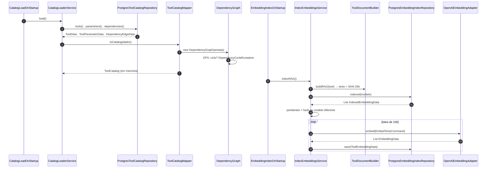

## 2. Login com Google

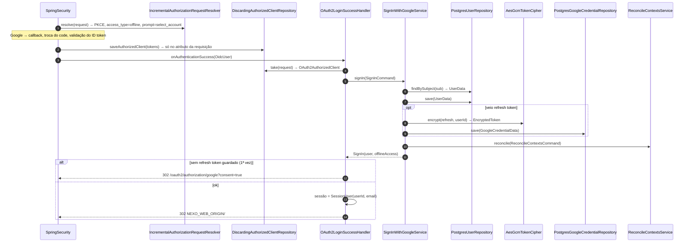

## 3. Ligar contexto com consentimento

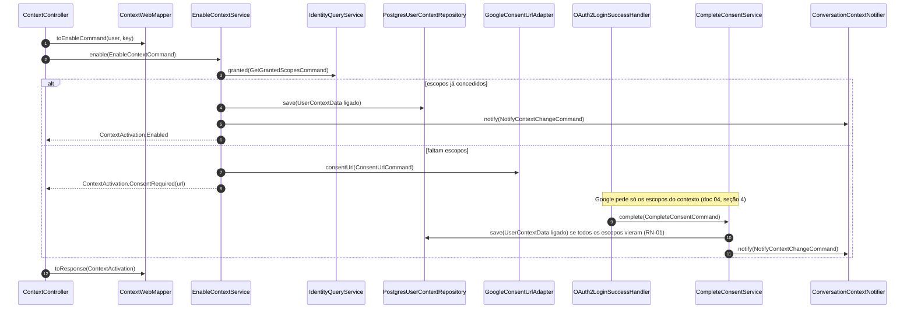

## 4. Abrir o WebSocket e reproduzir eventos

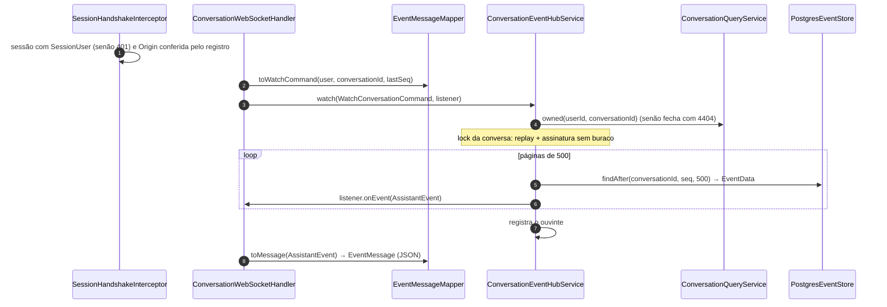

## 5. Enviar mensagem e conduzir o turno

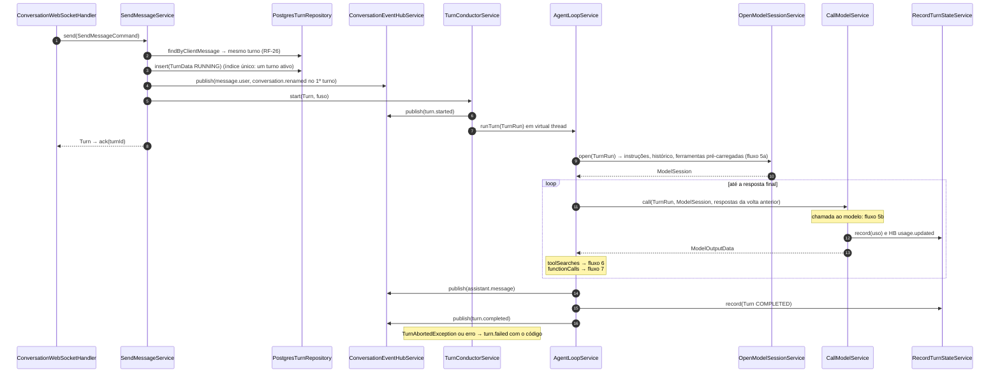

### 5a. Abrir a sessão com o modelo

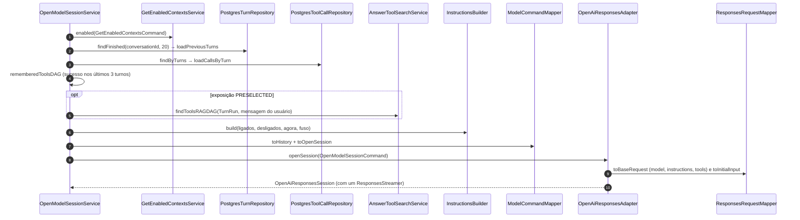

### 5b. Uma chamada ao modelo

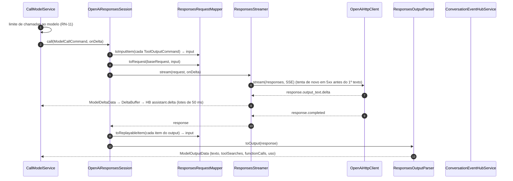

## 6. Responder ao tool search

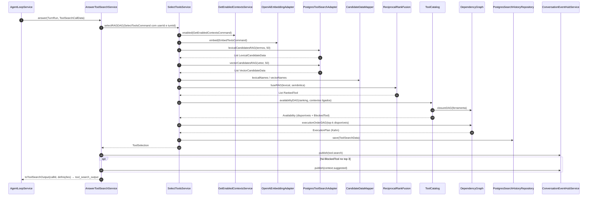

## 7. Admitir e executar uma chamada

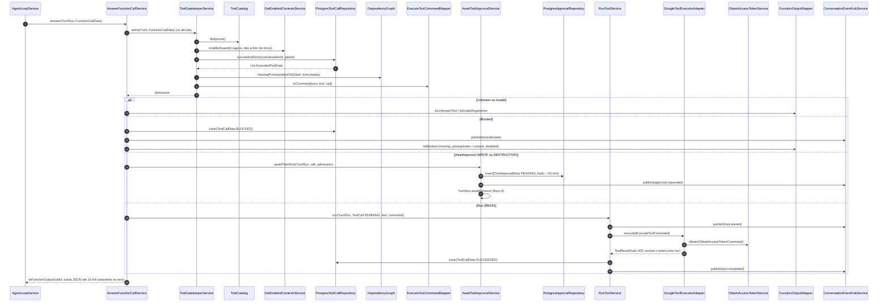

## 8. Decidir uma aprovação

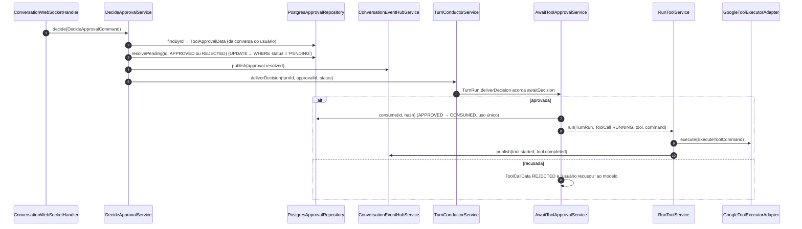

## 9. Vencer aprovações e recuperar turnos

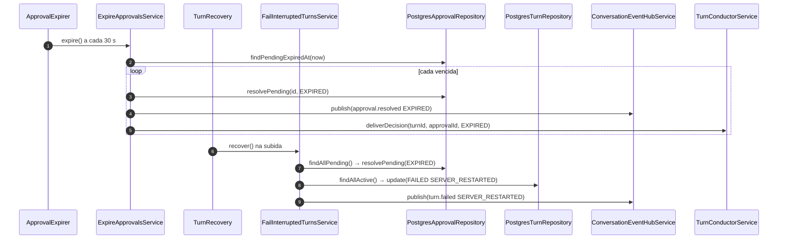
