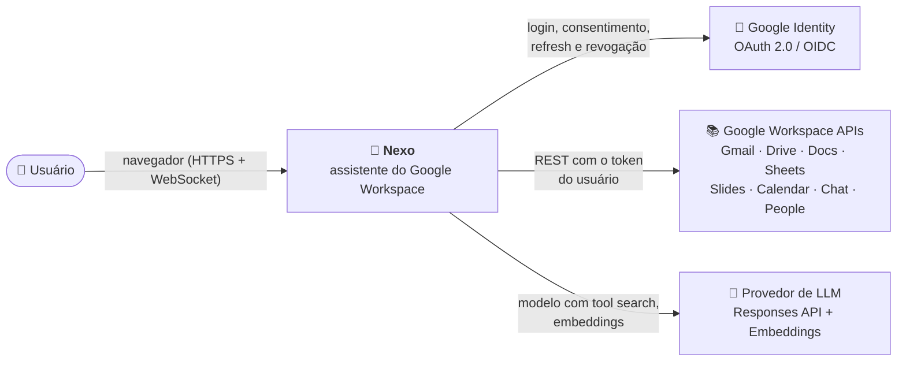
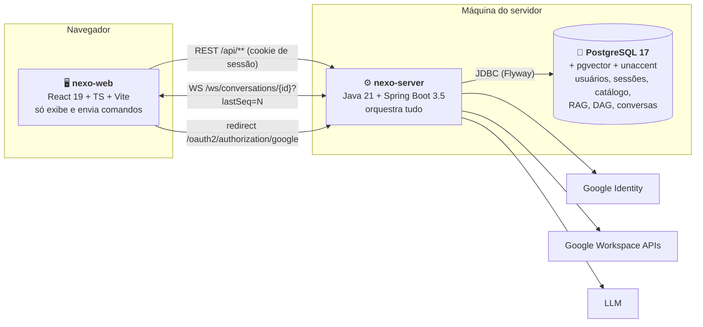
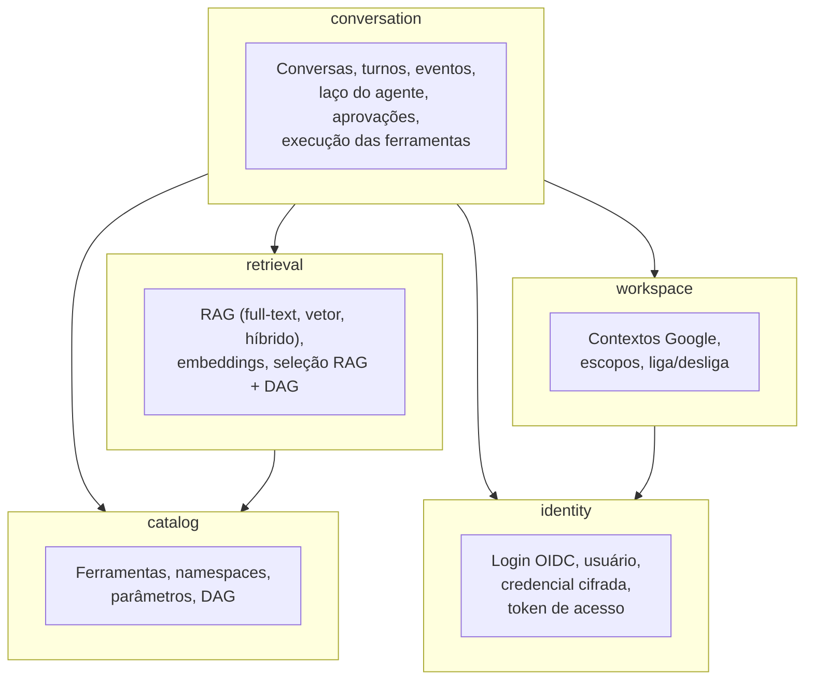

# 03 · Arquitetura

Visão em três zooms (modelo C4) e depois a organização do código, que segue as regras das skills
`java-clean-ddd` e `java-code-style`.

## 1. Contexto (C4 nível 1)



| Ator / sistema | Papel |
|---|---|
| Usuário | Entra com Google, liga contextos, conversa, aprova alterações |
| Google Identity | Autentica e emite tokens com os escopos consentidos |
| Google Workspace APIs | Onde as ferramentas agem |
| Provedor de LLM | Raciocina e pede ferramentas; gera embeddings. **Nunca** recebe tokens do Google |

## 2. Contêineres (C4 nível 2)



| Contêiner | Responsabilidade | Não faz |
|---|---|---|
| **nexo-web** | Login (botão), tela de contextos, chat, cartões de ferramenta e de aprovação; reconecta o WS com `lastSeq` | Não guarda token, não fala com Google nem com o LLM |
| **nexo-server** | BFF de autenticação, contextos, catálogo, tool search (RAG + DAG), laço do agente, execução das ferramentas, Event Store, WebSocket | Não expõe tokens; não deixa o modelo decidir permissões |
| **PostgreSQL** | Dados e índices (GIN full-text, HNSW pgvector) | Não roda estratégia: RAG e DAG são código |

## 3. Componentes do nexo-server (C4 nível 3)

Cinco contextos delimitados (bounded contexts). As setas são dependências de código.



| Contexto | Agregados / modelos principais | Casos de uso |
|---|---|---|
| `identity` | `User`, `UserId`, `GoogleSubject`, `GoogleCredential`, `EncryptedToken`, `GrantedScopes`, `AccessToken` | `SignInWithGoogleUseCase`, `GetCurrentUserUseCase`, `ObtainAccessTokenUseCase`, `DisconnectGoogleUseCase` |
| `workspace` | `GoogleContext`, `ContextKey`, `UserContext`, `ContextActivation` (sealed: `Enabled` · `ConsentRequired`) | `ListContextsUseCase`, `EnableContextUseCase`, `CompleteConsentUseCase`, `DisableContextUseCase` |
| `catalog` | `Tool`, `ToolName`, `ToolParameter`, `ToolEffect`, `ToolCatalog`, `DependencyGraph`, `ExecutionPlan`, `PlanStep`, `Availability`, `BlockedTool` | `LoadCatalogUseCase`, `ProvideCatalogUseCase`, `DescribeCatalogUseCase`, `ListToolsUseCase`, `GetToolUseCase`, `PlanExecutionUseCase` |
| `retrieval` | `RankedTool`, `ReciprocalRankFusion`, `Embedding`, `ToolSelection`, `SelectedTool`, `SelectionOrigin`, `RetrievalStrategy`, `ToolDocument` | `SelectToolsUseCase`, `IndexEmbeddingsUseCase`, `ListSearchHistoryUseCase` |
| `conversation` | `Conversation`, `ConversationId`, `Turn`, `TurnStatus`, `AssistantEvent`, `NewEvent`, `EventType`, `ToolCall`, `ToolApproval`, `ApprovalStatus`, `ApprovalDecision` | `CreateConversationUseCase`, `ListConversationsUseCase`, `RenameConversationUseCase`, `DeleteConversationUseCase`, `SendMessageUseCase`, `WatchConversationUseCase`, `ReadEventsUseCase`, `ListApprovalsUseCase`, `DecideApprovalUseCase`, `StopTurnUseCase`, `FailInterruptedTurnsUseCase`, `ExpireApprovalsUseCase`, `PublishContextChangeUseCase` |

Tipos compartilhados (`UserId`, `ContextKey`) ficam em `core/shared/domain/model`: é o único
shared kernel permitido.

## 4. Organização dos pacotes

Base: `io.github.caiomc.nexo`. Cada pacote tem **um motivo para mudar** (skill `java-clean-ddd`,
seção 1), e todo objeto simples (só dados) mora num pacote `command` ou `data` (seção 4.2).

```
io.github.caiomc.nexo
├── NexoApplication
├── core/                                      regra de negócio — sem Spring Web, JDBC, HTTP, Jackson, SDKs
│   ├── shared/domain/model/                   UserId, ContextKey
│   ├── identity/
│   │   ├── domain/model/                      User, SignIn, GoogleCredential, EncryptedToken, GrantedScopes, AccessToken
│   │   ├── domain/exception/                  ConsentRevokedException, GoogleCredentialMissingException, UserNotFoundException
│   │   ├── port/oauth/ (+ command/, data/)    GoogleOAuthPort · RefreshTokenCommand, RevokeTokenCommand · TokenData
│   │   ├── port/crypto/                       TokenCipherPort
│   │   ├── port/repository/ (+ data/)         UserRepository, GoogleCredentialRepository · UserData, GoogleCredentialData
│   │   ├── port/cache/                        AccessTokenCache
│   │   ├── usecase/                           SignInWithGoogleUseCase, ObtainAccessTokenUseCase, GetCurrentUserUseCase,
│   │   │                                      GetGrantedScopesUseCase, DisconnectGoogleUseCase
│   │   ├── usecase/command/                   SignInCommand, ObtainAccessTokenCommand, GetCurrentUserCommand,
│   │   │                                      GetGrantedScopesCommand, DisconnectGoogleCommand
│   │   ├── mapper/                            UserDataMapper, GoogleCredentialDataMapper, IdentityCommandMapper
│   │   └── application/                       SignInWithGoogleService, ObtainAccessTokenService, IdentityQueryService,
│   │                                          DisconnectGoogleService
│   ├── workspace/
│   │   ├── domain/model/                      GoogleContext, UserContext, ContextState, ContextActivation (sealed)
│   │   ├── domain/exception/                  ContextNotFoundException, ScopesNotGrantedException
│   │   ├── port/repository/ (+ data/)         GoogleContextRepository, UserContextRepository ·
│   │   │                                      GoogleContextData, GoogleContextScopeData, UserContextData
│   │   ├── port/consent/ (+ command/)         ConsentUrlPort · ConsentUrlCommand
│   │   ├── port/notification/ (+ command/)    ContextChangeNotifierPort · NotifyContextChangeCommand
│   │   ├── usecase/                           ListContextsUseCase, EnableContextUseCase, DisableContextUseCase,
│   │   │                                      CompleteConsentUseCase, FindContextUseCase, GetEnabledContextsUseCase,
│   │   │                                      ReconcileContextsUseCase
│   │   ├── usecase/command/                   um Command por caso de uso (EnableContextCommand, CompleteConsentCommand...)
│   │   ├── mapper/                            GoogleContextDataMapper, UserContextDataMapper, WorkspaceCommandMapper
│   │   └── application/                       ContextDirectoryService, GetEnabledContextsService, ListContextsService, EnableContextService,
│   │                                          DisableContextService, CompleteConsentService, ReconcileContextsService
│   ├── catalog/
│   │   ├── domain/model/                      Tool, ToolName, ToolParameter, ParameterType, ToolEffect, ToolCatalog,
│   │   │                                      DependencyGraph, ExecutionPlan, PlanStep, Availability, BlockedTool,
│   │   │                                      ToolDetail, CatalogOverview, ContextSummary
│   │   ├── domain/exception/                  ToolNotFoundException, DependencyCycleException
│   │   ├── port/repository/ (+ data/)         ToolCatalogRepository · ToolData, ToolParameterData, DependencyEdgeData
│   │   ├── usecase/ (+ command/)              LoadCatalogUseCase, ProvideCatalogUseCase, DescribeCatalogUseCase,
│   │   │                                      ListToolsUseCase, GetToolUseCase, PlanExecutionUseCase
│   │   ├── mapper/                            ToolCatalogMapper (Data → ToolCatalog + DependencyGraph)
│   │   └── application/                       CatalogLoaderService, CatalogQueryService, PlanExecutionService
│   ├── retrieval/
│   │   ├── domain/model/                      Embedding, RankedTool, ToolSelection, SelectedTool, ToolDocument,
│   │   │                                      SearchRecord, SearchRecordResult
│   │   ├── domain/enums/                      RetrievalStrategy, SelectionOrigin
│   │   ├── domain/policy/                     ReciprocalRankFusion, LexicalTermsBuilder, ToolDocumentBuilder
│   │   ├── port/search/ (+ data/)             ToolSearchPort · LexicalCandidateData, VectorCandidateData
│   │   ├── port/embedding/ (+ command/, data/) EmbeddingPort, EmbeddingIndexRepository · EmbedTextsCommand ·
│   │   │                                      EmbeddingData, IndexedEmbeddingData, ToolEmbeddingData
│   │   ├── port/history/ (+ data/)            SearchHistoryRepository · ToolSearchData, ToolSearchResultData
│   │   ├── usecase/ (+ command/)              SelectToolsUseCase, ListSearchHistoryUseCase, IndexEmbeddingsUseCase ·
│   │   │                                      SelectToolsCommand, ListSearchHistoryCommand
│   │   ├── mapper/                            CandidateDataMapper, EmbeddingDataMapper, SearchHistoryDataMapper,
│   │   │                                      RetrievalCommandMapper
│   │   └── application/                       SelectToolsService, SearchHistoryService, IndexEmbeddingsService, RetrievalSettings
│   └── conversation/
│       ├── domain/model/                      Conversation, ConversationView, Turn, Usage, ToolCall, ToolApproval,
│       │                                      NewEvent, AssistantEvent, Admission (sealed)
│       ├── domain/enums/                      TurnStatus, FailureCode, ToolCallStatus, BlockReason, ApprovalStatus,
│       │                                      ApprovalDecision, Severity, ToolExposure, EventType
│       ├── domain/exception/                  ConversationNotFoundException, TurnInProgressException, NoActiveTurnException,
│       │                                      ApprovalNotFoundException, ApprovalNotPendingException, ApprovalExpiredException,
│       │                                      ModelNotConfiguredException, TurnAbortedException
│       ├── domain/policy/                     ArgumentsValidator, ArgumentsHasher, InstructionsBuilder, DeltaBuffer,
│       │                                      ConversationEvents (fábrica dos eventos)
│       ├── port/model/                        LanguageModelPort, ModelSession
│       ├── port/model/command/                OpenModelSessionCommand, ModelCallCommand, HistoryMessageCommand,  
│       │                                      ToolOutputCommand (sealed: SearchResult, FunctionResult)
│       ├── port/model/data/                   ModelOutputData, ToolSearchCallData, FunctionCallData, ModelDeltaData, UsageData
│       ├── port/tool/ (+ command/, data/)     ToolExecutorPort · ExecuteToolCommand · ToolResultData, ToolOutcome
│       ├── port/approval/ (+ command/)        ApprovalDescriberPort · DescribeApprovalCommand
│       ├── port/event/ (+ command/, data/)    EventStorePort · AppendEventCommand · EventData
│       ├── port/repository/ (+ data/)         ConversationRepository, TurnRepository, ToolCallRepository, ApprovalRepository ·
│       │                                      ConversationData, TurnData, ToolCallData, ExecutedToolData, ToolApprovalData
│       ├── usecase/                           CreateConversationUseCase, ListConversationsUseCase, GetConversationUseCase,
│       │                                      RenameConversationUseCase, DeleteConversationUseCase, ReadEventsUseCase,
│       │                                      ListApprovalsUseCase, WatchConversationUseCase, SendMessageUseCase,
│       │                                      DecideApprovalUseCase, StopTurnUseCase, ExpireApprovalsUseCase,
│       │                                      FailInterruptedTurnsUseCase, PublishContextChangeUseCase,
│       │                                      ConversationEventListener, ConversationWatch
│       ├── usecase/command/                   um Command por caso de uso (SendMessageCommand, DecideApprovalCommand...)
│       ├── mapper/                            ConversationDataMapper, TurnDataMapper, ToolCallDataMapper, ExecutedToolMapper,
│       │                                      ToolApprovalDataMapper, EventDataMapper, ExecuteToolCommandMapper,
│       │                                      AgentCommandMapper, ModelCommandMapper, FunctionOutputMapper
│       ├── application/                       AgentSettings, ConversationEventHubService, ConversationQueryService,
│       │                                      ConversationCommandService, SendMessageService, DecideApprovalService,
│       │                                      StopTurnService, ExpireApprovalsService, FailInterruptedTurnsService,
│       │                                      PublishContextChangeService
│       └── application/agent/                 o turno rodando, uma classe por etapa: TurnConductorService, TurnRun, AgentLoopService,
│                                              OpenModelSessionService, CallModelService, AnswerToolSearchService, AnswerFunctionCallService,
│                                              ToolGatekeeperService, AwaitToolApprovalService, RunToolService, RecordTurnStateService
└── adapters/
    ├── shared/                                openai/{OpenAiHttpClient (JSON e SSE), OpenAiSettings}, persistence/{SqlArrays,
    │                                          JsonColumns}, web/handler/ProblemDetails, config/{SharedConfig, OpenAiProperties}
    ├── identity/
    │   ├── security/                          SecurityConfig, SessionUser, IncrementalAuthorizationRequestResolver,
    │   │                                      OAuth2LoginSuccessHandler, OAuth2LoginFailureHandler,
    │   │                                      DiscardingAuthorizedClientRepository, OAuthSessionAttributes, CsrfCookieFilter,
    │   │                                      ProblemSecurityHandlers, mapper/OAuth2SignInMapper
    │   ├── google/                            GoogleOAuthAdapter (refresh e revoke)
    │   ├── crypto/                            AesGcmTokenCipher
    │   ├── cache/                             InMemoryAccessTokenCache
    │   ├── persistence/                       PostgresUserRepository, PostgresGoogleCredentialRepository
    │   ├── web/{controller,response,mapper,handler}/  MeController, AuthController, MeResponse, IdentityWebMapper,
    │   │                                      IdentityExceptionHandler
    │   └── config/                            IdentityProperties, IdentityConfig
    ├── workspace/
    │   ├── persistence/                       PostgresGoogleContextRepository, PostgresUserContextRepository
    │   ├── google/                            GoogleConsentUrlAdapter
    │   ├── notification/                      ConversationContextNotifier (chama PublishContextChangeUseCase)
    │   └── web/{controller,response,mapper,handler}/  ContextController, ContextResponse, ContextActivationResponse,
    │                                          ContextWebMapper, WorkspaceExceptionHandler
    ├── catalog/
    │   ├── persistence/                       PostgresToolCatalogRepository
    │   ├── scheduling/                        CatalogLoadOnStartup
    │   └── web/{controller,response,mapper,handler}/
    ├── retrieval/
    │   ├── persistence/                       PostgresToolSearchAdapter, PostgresEmbeddingIndexRepository,
    │   │                                      PostgresSearchHistoryRepository, PgVectors
    │   ├── openai/                            OpenAiEmbeddingAdapter
    │   ├── scheduling/                        EmbeddingIndexOnStartup
    │   └── web/{controller,request,response,mapper,handler}/
    └── conversation/
        ├── openai/                            OpenAiResponsesAdapter, OpenAiResponsesSession, ResponsesStreamer,
        │                                      mapper/{ResponsesRequestMapper, ResponsesToolMapper, ResponsesOutputParser}
        ├── google/                            GoogleToolExecutorAdapter, GoogleApiClient, GoogleApiEndpoints, GoogleRequest,
        │                                      GoogleCall, GoogleApiException, ApprovalDescriber, ResultSummarizer,
        │                                      executor/{Gmail,Drive,Docs,Sheets,Slides,Calendar,Chat,People}Executor
        ├── persistence/                       PostgresEventStore, PostgresConversationRepository, PostgresTurnRepository,
        │                                      PostgresToolCallRepository, PostgresApprovalRepository
        ├── websocket/handler/                 ConversationWebSocketHandler, SessionHandshakeInterceptor, WebSocketConfig
        ├── websocket/{message,mapper}/        ClientCommandMessage, EventMessage, AckMessage, NackMessage · EventMessageMapper
        ├── scheduling/                        ApprovalExpirer, TurnRecovery
        ├── web/{controller,request,response,mapper,handler}/  ConversationController, ConversationWebMapper...
        └── config/                            AgentProperties, ConversationConfig
```

### 4.1 Onde fica cada decisão

| Decisão | Onde | Por quê |
|---|---|---|
| "Esta ferramenta pode rodar agora?" (contexto, pré-requisito, aprovação) | `ToolGatekeeperService` (core) | Regra de negócio; testável sem Spring |
| "Quais ferramentas mandar ao modelo?" | `SelectToolsService` + `ReciprocalRankFusion` + `DependencyGraph` (core) | Estratégia no código; o banco só devolve candidatos pelos índices |
| "Qual a ordem de execução? Falta pré-requisito? Há ciclo?" | `DependencyGraph` (core, montado uma vez pelo `CatalogLoaderService`) | Kahn, fecho e trava em Java, testáveis sem banco |
| "Como Data vira domínio?" | `core/<ctx>/mapper/*DataMapper` | Services não montam objetos (seção 4.2) |
| "Como chamar a API do Google X?" | `*Executor` (adapter) | Tecnologia |
| "Como falar com o LLM?" | `OpenAiResponsesAdapter` (adapter) | Trocar de provedor = novo adapter de `LanguageModelPort` |
| "Como ciframos o token?" | `AesGcmTokenCipher` (adapter) | Algoritmo é tecnologia; o core só vê `EncryptedToken` |
| Formato JSON do WebSocket | `websocket/message` + `EventMessageMapper` | DTO só dados; conversão no mapper |

### 4.2 Convenção de objetos: `...Command` e `...Data`

Todo objeto que é **só dados** (record sem regra) tem nome e pacote que dizem **de onde veio**:

| Sufixo | O que é | Pacote | Exemplos |
|---|---|---|---|
| `...Command` | Entrada que **veio do usuário** (REST, WebSocket, callback do login) e chega a um caso de uso; ou pedido que o core manda para uma porta | `usecase/command/` · `port/<assunto>/command/` | `SendMessageCommand`, `EnableContextCommand`, `SelectToolsCommand`, `ExecuteToolCommand` |
| `...Data` | O que **veio do banco** (leitura de repositório) ou de outro sistema externo pela porta | `port/<assunto>/data/` | `ToolData`, `DependencyEdgeData`, `LexicalCandidateData`, `ExecutedToolData`, `TokenData`, `ToolResultData` |
| `...Request` / `...Response` / `...Message` | Formato HTTP/WS, só na borda | `adapters/<ctx>/web/{request,response}`, `websocket/message` | `SelectToolsRequest`, `ContextResponse`, `EventMessage` |
| (sem sufixo) | Modelo de domínio com identidade ou regra | `domain/model` | `Turn`, `ToolCatalog`, `DependencyGraph` |

Regras:

1. **Service não cria objeto simples.** Nenhum `record`/classe declarado dentro de um `*Service` (nem
   privado, nem aninhado), e nenhum `new XxxCommand(...)` / `new XxxData(...)` montado à mão no meio do
   método: a conversão fica num mapper e o tipo, no seu pacote `command` ou `data`. Comando para
   outro contexto também: `IdentityCommandMapper`, `WorkspaceCommandMapper`, `RetrievalCommandMapper`
   e `AgentCommandMapper` montam os `...Command` que um serviço manda a outro caso de uso.
2. **Repositórios falam só `...Data`**, nos dois sentidos (`save(TurnData)`, `List<ToolData> tools()`).
   A conversão `Data ⇄ domínio` fica em `core/<ctx>/mapper/*DataMapper`; o adapter de persistência
   só converte `ResultSet ⇄ Data`.
3. **Caso de uso recebe só `...Command`** (inclusive consultas: `ListConversationsCommand`,
   `GetToolCommand`). O `*WebMapper` / `EventMessageMapper` converte `Request`/`Message` → `Command`.
4. Entidades de domínio nascem por **fábricas do próprio domínio** (`Turn.start(...)`,
   `ToolApproval.pending(...)`), chamadas pelos mappers ou pelo domínio, não por `new` solto no service.
5. Um tipo por arquivo; nada de `record` aninhado em porta, mapper ou service (exceção: as variantes de
   um `sealed interface`, como `ToolOutputCommand.SearchResult` e `Admission.Blocked`).

Fluxo típico (enviar mensagem):

```
ClientCommandMessage ─EventMessageMapper─▶ SendMessageCommand ─▶ SendMessageService
      SendMessageService ─TurnDataMapper─▶ TurnData ─▶ TurnRepository.save
      TurnRepository.findActive ─▶ TurnData ─TurnDataMapper─▶ Turn
```

### 4.3 Regras de dependência

1. `core` não importa nada de `adapters`, nem `org.springframework.web`, `java.sql`, `java.net.http`, Jackson ou SDKs.
   Spring só via `@Service` nas classes de `application` (como no alien-code).
2. Um contexto usa outro **só** pelos casos de uso (`usecase/`) ou pelos tipos do shared kernel. Ex.: o
   `GoogleToolExecutorAdapter` obtém o token chamando `ObtainAccessTokenUseCase`, nunca o repositório de credenciais.
3. Controllers e handlers de WebSocket: traduzem (mapper) e delegam (use case). Nada mais.
4. Tempo sempre por `Clock` injetado.

## 5. Stack

| Camada | Tecnologia | Observação |
|---|---|---|
| Linguagem | Java 21 | records, sealed, pattern matching, virtual threads |
| Framework | Spring Boot 3.5 | `web`, `websocket`, `security`, `oauth2-client`, `jdbc`, `validation`, `actuator` |
| Sessão | Spring Session JDBC | sessão no PostgreSQL: sobrevive a reinício |
| Banco | PostgreSQL 17 + pgvector 0.8 + unaccent | imagem `pgvector/pgvector:pg17` |
| Migrations | Flyway | `V1..V8`, seed do catálogo gerado; só tabelas e índices |
| Acesso a dados | `JdbcClient` | SQL explícito e simples; adapters devolvem `...Data`; nenhuma função SQL de RAG/DAG |
| HTTP de saída | `RestClient` (Spring) | Google REST e OpenAI; sem SDKs no core |
| LLM | OpenAI Responses API (tool search, streaming SSE) | **(proposta)**, atrás de `LanguageModelPort` |
| Embeddings | `text-embedding-3-small` (1536) | **(proposta)**, atrás de `EmbeddingPort` |
| Testes | JUnit 5, AssertJ, Spring Boot Test, Testcontainers (pgvector), WireMock ou `HttpServer` do JDK | doc 14 |
| Front | React 19, TypeScript, Vite, Vitest | mesmo stack do `alien-web` |

## 6. Concorrência

- Cada turno roda numa **virtual thread** do `TurnConductorService`; uma conversa tem no máximo um turno ativo (trava em memória por `ConversationId` + coluna `status` no banco).
- O turno **pausa** em aprovação pendente sem segurar thread: o estado fica em `turn`/`tool_approval`; a decisão retoma o turno numa nova virtual thread a partir do `ModelSession` guardado em memória (se o servidor reiniciou, o turno vira `FAILED`, RNF-08).
- `ConversationEventHubService` serializa gravações por conversa (o `seq` é atribuído no banco: `max(seq)+1` sob `SELECT ... FOR UPDATE` da linha da conversa) e entrega aos ouvintes depois do commit.

## 7. Configuração (`.env`)

Como no `dta-tool-search`: o servidor lê o `.env` da raiz do repositório (modelo em
[`.env.example`](../../.env.example)), e variável exportada no terminal tem prioridade. O `.env` está no
`.gitignore` e nunca é versionado; chaves não aparecem em spec, log nem response (doc 13).

| Variável | Padrão | Uso |
|---|---|---|
| `OPENAI_API_KEY` | — (obrigatória para LLM e embeddings) | Chave do provedor ou do proxy |
| `OPENAI_BASE_URL` | `https://api.openai.com/v1` | Servidor compatível com a API da OpenAI. **Na POC: proxy de fronteira da DTA** (`https://proxy.dta.totvs.ai/v1`), que expõe `gpt-5.4-mini` e `text-embedding-3-small` |
| `OPENAI_MODEL` | `gpt-5.4-mini` | Modelo do agente (precisa de `gpt-5.4`+ para tool search no cliente) |
| `OPENAI_EMBEDDING_MODEL` | `text-embedding-3-small` | Embeddings do RAG (1536 dimensões, casa com `vector(1536)`) |
| `OPENAI_TIMEOUT_SECONDS` | `120` | Timeout por chamada |
| `NEXO_DB_URL` · `NEXO_DB_USER` · `NEXO_DB_PASSWORD` | `jdbc:postgresql://127.0.0.1:5433/nexo` · `nexo` · `nexo` | Banco do `compose.yaml` |
| `GOOGLE_CLIENT_ID` · `GOOGLE_CLIENT_SECRET` | — (sem eles o login não funciona) | Cliente OAuth Web do Google Cloud (doc 04, seção 2) |
| `NEXO_TOKEN_KEY` · `NEXO_TOKEN_KEY_VERSION` | vazia · `1` | AES-256 em Base64 que cifra os refresh tokens. Vazia = chave aleatória por subida (só dev: depois de reiniciar, todos entram de novo) |
| `NEXO_WEB_ORIGIN` | `http://localhost:5173` | Destino depois do login e única origem aceita no WebSocket |
| `NEXO_SERVER_URL` | `http://localhost:8080` | Monta o redirect URI do OAuth |
| `NEXO_GOOGLE_API_BASE` | vazio (APIs reais) | Só testes: todas as APIs do Google sob uma URL local |

Sem `OPENAI_API_KEY`, o servidor sobe mesmo assim: a busca cai para `FULL_TEXT` e o health
`embeddings` fica `DOWN` (doc 09).

