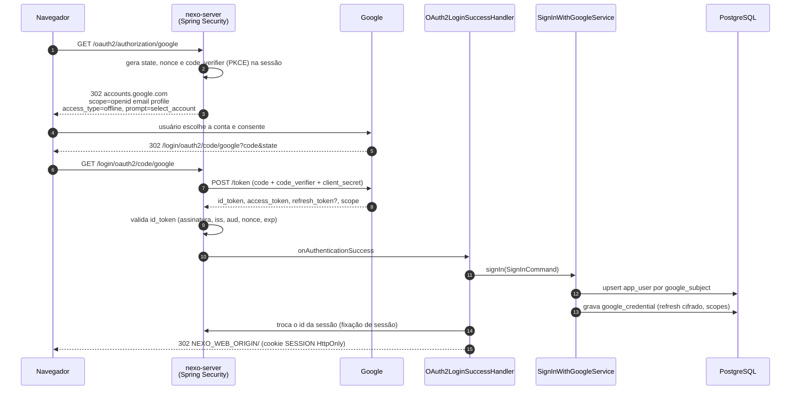
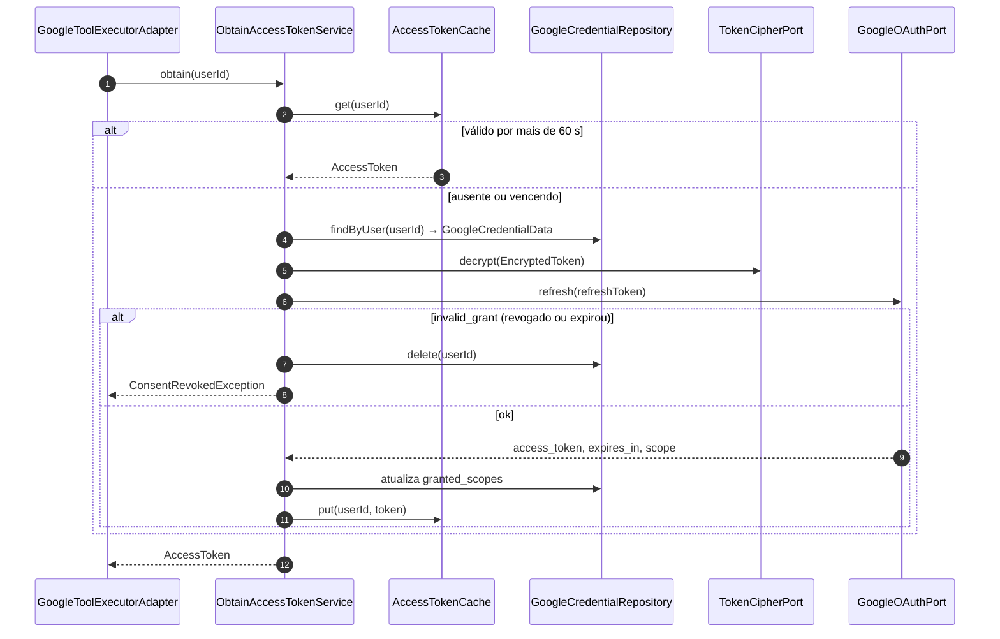

# 04 · Autenticação com Google

## 1. Decisão em resumo

- **Só Google** (RF-01), via **OpenID Connect** com o fluxo *Authorization Code* + **PKCE**.
- Padrão **BFF** (*Backend for Frontend*): quem fala com o Google é o `nexo-server`, um cliente
  **confidencial** (tem `client_secret`). O navegador só recebe um cookie de sessão. ([ADR-0004](../adr/0004-oauth-google-bff.md))
- O *client ID* do OAuth é **do aplicativo** (um por instalação do Nexo), não do usuário. O que é do
  usuário é o par **access token / refresh token** que o Google emite depois do consentimento. É esse
  token que o servidor usa para chamar as APIs em nome do usuário. O modelo de linguagem **nunca**
  recebe token nenhum: ele pede `google_calendar_list_events(...)` e o servidor executa.

## 2. Configuração no Google Cloud

| Item | Valor |
|---|---|
| Tipo do OAuth Client | Web application |
| Redirect URI (dev) | `http://localhost:8080/login/oauth2/code/google` |
| Origem JavaScript (dev) | `http://localhost:5173` |
| Tela de consentimento | Modo **Testing**, usuários de teste cadastrados |
| APIs habilitadas | `gmail`, `drive`, `docs`, `sheets`, `slides`, `calendar-json`, `chat`, `people` |

Variáveis de ambiente do servidor:

| Variável | Uso |
|---|---|
| `GOOGLE_CLIENT_ID` · `GOOGLE_CLIENT_SECRET` | Cliente OAuth |
| `NEXO_TOKEN_KEY` | Chave AES-256 em Base64 (32 bytes) para cifrar refresh tokens |
| `NEXO_TOKEN_KEY_VERSION` | Versão da chave atual (padrão `1`) |
| `NEXO_WEB_ORIGIN` | Origem permitida do front (`http://localhost:5173`) |

## 3. Fluxo de login

- Usuário novo: todos os contextos **desligados** (RF-02 / HU-01).
- Se o Google não devolver `refresh_token` (usuário já tinha consentido antes) e não houver um
  salvo, o servidor refaz o pedido com `prompt=consent` uma única vez.
- O `access_token` fica **só em memória** (cache por usuário até `expires_at - 60 s`); o banco guarda
  apenas o `refresh_token` cifrado.

## 4. Consentimento incremental (ligar um contexto)

Detalhado no [doc 05](05-contextos-google.md). Em resumo: `POST /api/contexts/{key}/enable` devolve
`consent_required` com a URL `/oauth2/authorization/google?context=calendar`. O
`IncrementalAuthorizationRequestResolver` acrescenta:

| Parâmetro | Valor | Por quê |
|---|---|---|
| `scope` | `openid email profile` + escopos do contexto | Pede só o que falta |
| `include_granted_scopes` | `true` | O novo token soma os escopos já concedidos |
| `access_type` | `offline` | Garante refresh token |
| `prompt` | `consent` | Garante que o Google devolve um refresh token novo, cobrindo a soma |
| `login_hint` | e-mail do usuário logado | Evita trocar de conta no meio |

No retorno, o `OAuth2LoginSuccessHandler` vê o atributo de sessão `nexo.pendingContext` e chama
`CompleteConsentUseCase` depois do login. Se o `sub` do retorno for diferente do usuário que pediu o
consentimento (`nexo.pendingUser`, gravado pelo resolver), nada é gravado: a sessão volta para o usuário
original e o navegador vai a `/settings/contexts?denied=<ctx>&reason=account_mismatch`.

Como o login comum também manda `include_granted_scopes=true`, o access token de qualquer login traz a
soma dos escopos já concedidos; o `SignInWithGoogleService` reconcilia os contextos com ela.

## 5. Token de acesso em tempo de execução

`ConsentRevokedException` vira, no turno, um `turn.failed` com código `GOOGLE_RECONNECT_REQUIRED`, e
o front leva o usuário ao login de novo.

## 6. Cifra do refresh token

| Item | Valor |
|---|---|
| Algoritmo | AES-256-GCM (`AesGcmTokenCipher`) |
| IV | 12 bytes aleatórios por cifra (`SecureRandom`), guardado junto do texto cifrado |
| AAD | `user_id` — um token copiado para outra linha não decifra |
| Formato | `bytea` = `iv ‖ ciphertext ‖ tag`, mais coluna `key_version` |
| Rotação | Nova chave → `NEXO_TOKEN_KEY_VERSION=2` e `NEXO_TOKEN_KEY_V1` para leitura; tokens antigos são recifrados no próximo refresh |
| `toString()` | `EncryptedToken[***]`, nunca o conteúdo (skill `java-clean-ddd`, seção 4) |
| Sem `NEXO_TOKEN_KEY` | O servidor sobe com uma chave aleatória e avisa no log: os refresh tokens não decifram depois de reiniciar (todos entram de novo). Só para desenvolvimento |

## 7. Sessão e logout

| Item | Decisão |
|---|---|
| Armazenamento | Spring Session JDBC (`spring_session*`), expira após 8 h de inatividade |
| Conteúdo da sessão | Só `SessionUser(userId, email)` e atributos do fluxo OAuth. **Nada** de token do Google |
| Repositório de tokens do Spring | `OAuth2AuthorizedClientRepository` substituído por `DiscardingAuthorizedClientRepository`: guarda o cliente autorizado só num atributo da **requisição** do callback, para o handler levar o refresh token cifrado a `google_credential`. Nada vai para a sessão |
| Cookie | `SESSION`, `HttpOnly`, `SameSite=Lax`, `Secure` fora do localhost, `Path=/` |
| CSRF | `CookieCsrfTokenRepository` (cookie `XSRF-TOKEN` + cabeçalho `X-XSRF-TOKEN`) nas rotas REST que alteram estado |
| Logout | `POST /api/auth/logout`: invalida a sessão; credenciais continuam (próximo login não pede consentimento de novo) |
| Desconectar | `POST /api/auth/disconnect`: `POST https://oauth2.googleapis.com/revoke`, apaga `google_credential`, desliga todos os contextos, invalida a sessão (HU-06) |
| API sem sessão | `401` com Problem Details; **sem** redirect (o front decide) |

## 8. Escopos sensíveis e restritos

| Contexto | Classificação Google | Consequência fora da POC |
|---|---|---|
| Gmail (`gmail.modify`, `gmail.compose`), Drive (`drive`) | **Restritos** | Verificação + avaliação de segurança anual (CASA) |
| Calendar, Docs, Sheets, Slides, Contatos, Chat | **Sensíveis** | Verificação do app |
| `openid email profile` | Não sensíveis | — |

Na POC (modo Testing) nada disso é exigido, mas o refresh token expira em 7 dias. Para reduzir a
superfície, o roadmap prevê trocar `drive` por `drive.file` + Google Picker (doc 15, "Futuro").
