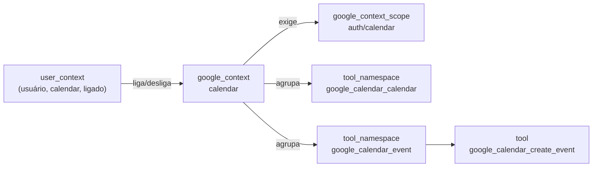
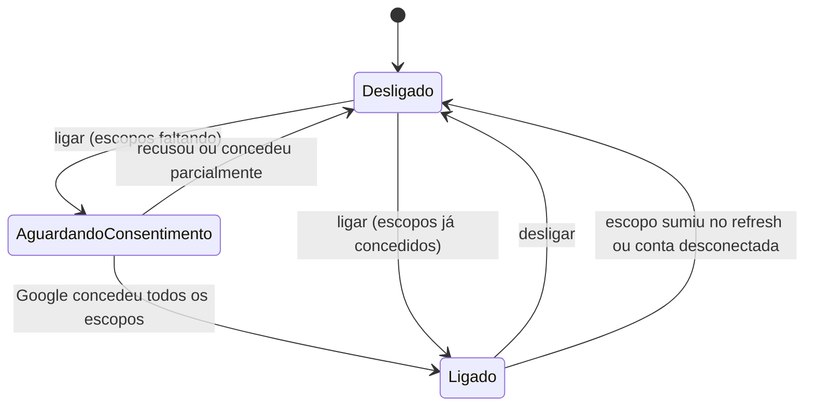
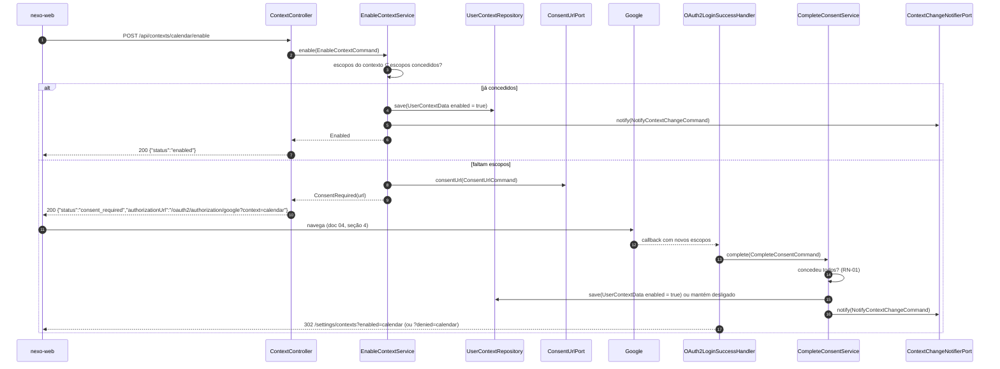

# 05 · Contextos Google

Um **contexto** é um produto Google que o usuário libera para o assistente. É a unidade de
permissão que o usuário enxerga; por baixo ela vira escopos OAuth (Google) e namespaces de
ferramentas (catálogo).



## 1. Contextos do seed

| Chave | Nome | Escopos | API | Ferramentas |
|---|---|---|---|:-:|
| `gmail` | Gmail | `gmail.modify`, `gmail.compose` | `gmail.googleapis.com` | 7 |
| `drive` | Drive | `drive` | `drive.googleapis.com` | 10 |
| `docs` | Docs | `documents` | `docs.googleapis.com` | 5 |
| `sheets` | Sheets | `spreadsheets` | `sheets.googleapis.com` | 6 |
| `slides` | Slides | `presentations` | `slides.googleapis.com` | 4 |
| `calendar` | Calendar | `calendar` | `calendar-json.googleapis.com` | 7 |
| `chat` | Chat | `chat.spaces.readonly`, `chat.memberships.readonly`, `chat.messages.readonly`, `chat.messages.create`, `chat.users.readstate` | `chat.googleapis.com` | 6 |
| `people` | Contatos | `userinfo.profile`, `contacts` | `people.googleapis.com` | 5 |

Todos os escopos têm o prefixo `https://www.googleapis.com/auth/`. A fonte é
[`../catalogo/google-tools.json`](../catalogo/google-tools.json).

> Diferença consciente em relação ao `google-tools`: lá Docs, Sheets e Slides pediam também o escopo
> `drive`. Aqui cada contexto pede só o escopo da própria API; achar o arquivo por nome é trabalho
> do contexto Drive (o usuário liga os dois se quiser buscar por nome).

## 2. Estados



`AguardandoConsentimento` não é gravado: é o atributo de sessão `nexo.pendingContext` durante o
redirecionamento. No banco, `user_context.enabled` é `true` ou `false`.

## 3. Ligar



## 4. Desligar

`POST /api/contexts/{key}/disable` → `DisableContextService` grava `enabled = false` e notifica.
Não chama o Google (RN-09): o Google só revoga o token **inteiro**. A partir desse instante:

1. `SelectToolsService` deixa de devolver ferramentas do contexto (`ToolCatalog.availabilityDAG`, no código);
2. `ToolGatekeeperService` recusa chamadas ao contexto mesmo que o modelo já tenha a definição (RN-03);
3. as conversas abertas recebem `context.changed`.

## 5. Contexto no prompt

Toda chamada ao modelo leva, nas instruções, a linha:

```
Contextos liberados pelo usuário: calendar, sheets. Contextos desligados: gmail, drive, docs, slides, chat, people.
Se o pedido precisar de um contexto desligado, diga qual e peça para o usuário ligá-lo; não tente contornar.
```

Isso responde à pergunta "o que o usuário autorizou?" sem gastar uma ferramenta. A lista é
recalculada a cada chamada ao modelo (barata: uma linha de `user_context`).

## 6. Sugestão de contexto

Quando a fusão (feita sobre candidatos sem filtro) tem, entre as 3 melhores, ferramentas de um contexto desligado, o
`SelectToolsService` devolve `BlockedTool(name, missingContexts)` e o turno emite
`context.suggested {"contexts":["gmail"],"reason":"..."}`. O front mostra um botão "Ligar Gmail".
A ferramenta bloqueada **não** é entregue ao modelo.

## 7. Regras

| Regra | Onde é garantida |
|---|---|
| RN-01 ligado ⇒ escopos concedidos | `EnableContextService`, `CompleteConsentService`; `ObtainAccessTokenService` desliga contextos cujos escopos sumiram no refresh |
| RN-02 disponibilidade pelo fecho | `ToolCatalog.availabilityDAG(...)` + `DependencyGraph.closureDAG(...)` (doc 09) |
| RN-03 desligado vale já | Filtro na busca + `ToolGatekeeperService` na execução |
| RN-09 desligar não revoga | `DisableContextService` não tem porta para o Google |
