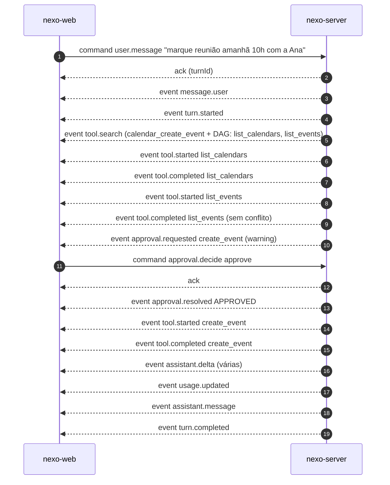

# 06 · Protocolo WebSocket

Mesmo desenho do `alien-code` (`MissionWebSocketHandler`): o servidor grava cada evento com um
número sequencial (`seq`) **antes** de enviar, e o cliente reconecta pedindo o que perdeu. A
diferença é que aqui o canal é **bidirecional de verdade**: o usuário manda mensagens e decisões
de aprovação por ele. ([ADR-0002](../adr/0002-websocket-com-replay-por-seq.md))

Contrato formal: [`../contratos/asyncapi.yaml`](../contratos/asyncapi.yaml).

## 1. Conexão

```
WS /ws/conversations/{conversationId}?lastSeq=N
```

| Item | Regra |
|---|---|
| Autenticação | Cookie `SESSION` no handshake (`SessionHandshakeInterceptor`). Sem sessão → recusa com HTTP 401 antes do upgrade |
| Origem | `Origin` precisa ser `NEXO_WEB_ORIGIN`; senão HTTP 403 (protege contra *cross-site WebSocket hijacking*) |
| Dono | Conversa de outro usuário ou inexistente → fecha com `4404` (não revela qual dos dois) |
| `lastSeq` | Opcional, padrão `0`. Inválido → fecha com `4400` |
| Replay | Envia, em ordem, os eventos com `seq > lastSeq` já gravados (páginas de 500); depois os novos, ao vivo, sem buraco nem repetição: o `ConversationEventHubService` reproduz e assina sob o mesmo lock da conversa em que grava + distribui, como o `MissionEventHub` do alien-code |
| Vários sockets | Permitidos (duas abas): todos recebem os mesmos eventos |
| Keep-alive | Servidor manda *ping* a cada 25 s; cliente sem *pong* por 60 s é fechado |
| Limites | Mensagem do cliente ≤ 16 KiB (o container fecha com `1009` acima disso); buffer de envio 4 MiB e 10 s (`ConcurrentWebSocketSessionDecorator`) |

## 2. Envelopes

Toda mensagem é um objeto JSON com `kind`. Três tipos:

| `kind` | Sentido | Persistido | Para quê |
|---|---|:-:|---|
| `event` | servidor → cliente | sim, com `seq` | Tudo que aconteceu na conversa |
| `ack` / `nack` | servidor → cliente | não | Resposta a um comando do cliente |
| `command` | cliente → servidor | não (o efeito vira `event`) | Pedido do usuário |

### 2.1 `event`

```json
{
  "kind": "event",
  "seq": 42,
  "conversationId": "c-7f3a9e21",
  "turnId": "t-0b19c4d2",
  "type": "tool.completed",
  "at": "2026-10-13T14:03:12.418Z",
  "payload": { "callId": "call_1", "tool": "google_calendar_list_events", "ok": true, "summary": "3 eventos amanhã" }
}
```

### 2.2 `command`

```json
{ "kind": "command", "id": "8a1f…", "type": "user.message", "payload": { "text": "o que tenho amanhã?" } }
```

`id` é gerado pelo cliente (UUID). Em `user.message` ele é o `clientMessageId` (idempotência, RF-26).

### 2.3 `ack` / `nack`

```json
{ "kind": "ack",  "commandId": "8a1f…", "turnId": "t-0b19c4d2" }
{ "kind": "nack", "commandId": "8a1f…", "code": "TURN_IN_PROGRESS", "message": "Já existe um turno em andamento nesta conversa." }
```

## 3. Comandos do cliente

| `type` | `payload` | Efeito | `nack` possíveis |
|---|---|---|---|
| `user.message` | `{ "text": string (1..8000), "timeZone"?: string IANA }` | Grava a mensagem, abre um turno. `timeZone` (do navegador) vai nas instruções do modelo | `TURN_IN_PROGRESS`, `INVALID_PAYLOAD`, `NOT_FOUND`, `MODEL_NOT_CONFIGURED` |
| `approval.decide` | `{ "approvalId": string, "decision": "approve" \| "reject" }` | Decide a aprovação e retoma o turno | `APPROVAL_NOT_PENDING`, `APPROVAL_EXPIRED`, `NOT_FOUND` |
| `turn.stop` | `{}` | Cancela o turno ativo (aprovações pendentes viram `REJECTED`) | `NO_ACTIVE_TURN` |

Comando com `type` desconhecido → `nack` `UNKNOWN_COMMAND`. JSON inválido → `nack` `INVALID_PAYLOAD` (sem `commandId`).

## 4. Eventos do servidor

| `type` | Quando | `payload` |
|---|---|---|
| `message.user` | Mensagem do usuário gravada | `{ text, clientMessageId }` |
| `turn.started` | Turno começou | `{ model, contexts: ["calendar", ...] }` |
| `assistant.delta` | Pedaço de texto da resposta | `{ text }` |
| `assistant.message` | Resposta final completa do turno | `{ text }` |
| `tool.search` | O modelo pediu ferramentas e o servidor respondeu | `{ goal, strategy, tools: [{ name, origin: "RAG"\|"DAG", score, level }], durationMs }` |
| `context.suggested` | A busca achou ferramentas de contexto desligado | `{ contexts: ["gmail"], tools: ["google_gmail_search"] }` |
| `tool.started` | Chamada vai executar | `{ callId, tool, effect, arguments }` |
| `tool.blocked` | Trava do DAG ou contexto desligado | `{ callId, tool, reason: "MISSING_PREREQUISITES"\|"CONTEXT_DISABLED", missing: [...] }` |
| `approval.requested` | Mutação pausada | `{ approvalId, callId, tool, description, severity: "warning"\|"danger", arguments, expiresAt }` |
| `approval.resolved` | Decidida ou vencida | `{ approvalId, status: "APPROVED"\|"REJECTED"\|"EXPIRED" }` |
| `tool.completed` | Chamada terminou | `{ callId, tool, ok, summary, error?, truncated }` |
| `usage.updated` | Depois de cada chamada ao modelo (acumulado do turno) | `{ modelCalls, inputTokens, cachedInputTokens, outputTokens }` |
| `turn.completed` | Fim normal | `{ durationMs, toolCalls, usage }` |
| `turn.failed` | Erro, limite (RN-11), parado ou reinício | `{ code, message }` |
| `context.changed` | Usuário ligou/desligou um contexto | `{ context, enabled }` |
| `conversation.renamed` | Título mudou (inclusive o automático do 1º turno) | `{ title }` |

Códigos de `turn.failed`: `STOPPED`, `LIMIT_MODEL_CALLS`, `LIMIT_TOOL_CALLS`, `TIMEOUT`,
`MODEL_ERROR`, `GOOGLE_RECONNECT_REQUIRED`, `SERVER_RESTARTED`.

`assistant.delta` é persistido como os outros (o replay remonta a resposta parcial), mas o
`PostgresEventStore` agrupa deltas em lotes de até 50 ms para não gravar um registro por token.

## 5. Um turno, do começo ao fim



`usage.updated` sai depois de **cada** chamada ao modelo (também entre as ferramentas, omitido acima),
então na última chamada ele chega antes de `assistant.message`. Testado em `AgentFlowIT`, cenário a cenário.

## 6. Reconexão no cliente

`ConversationSocket` (front) guarda o maior `seq` recebido e, ao cair, reconecta com
`lastSeq=<maior>` usando backoff exponencial (0,5 s → 8 s, com jitter). O reducer descarta evento com
`seq` ≤ maior já aplicado (idempotente), como o `MissionSocket` do `alien-web`.

## 7. Códigos de fechamento

| Código | Motivo |
|---|---|
| `1000` | Normal |
| `1009` | Mensagem do cliente maior que 16 KiB |
| `4400` | `lastSeq` ou caminho inválido |
| `4401` | Sessão expirou durante a conexão |
| `4404` | Conversa não existe ou não é do usuário |
| `4409` | Conversa apagada enquanto conectado |
