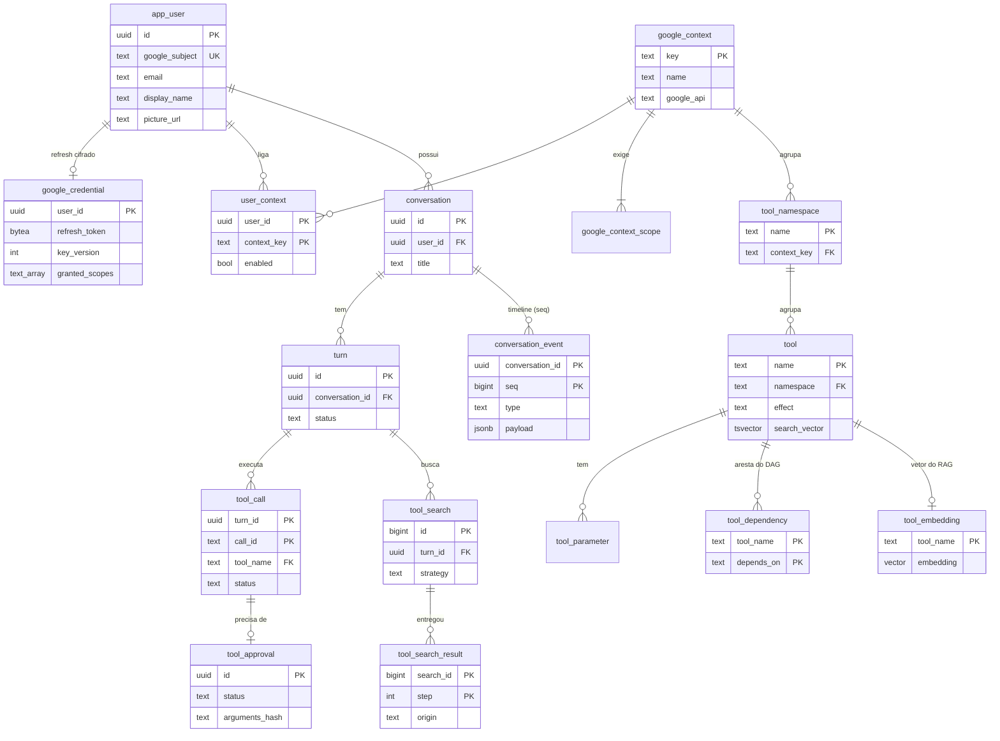

# 08 · Modelo de dados

PostgreSQL 17 com `pgvector` e `unaccent`, versionado por Flyway. A parte de catálogo, RAG e DAG
usa **as mesmas tabelas do [`tool-search-pg`](https://github.com/CaioMC/tool-search-pg)**
(`tool_namespace`, `tool`, `tool_parameter`, `tool_dependency`, `tool_embedding`, `tool_search*`),
com dois acréscimos: **contexto** no namespace e **efeito** na ferramenta.
([ADR-0003](../adr/0003-postgres-pgvector-catalogo-no-banco.md))

> **Regra:** o banco só **guarda e indexa**. Nenhuma função, view ou gatilho de RAG ou DAG. Os
> adapters fazem `SELECT`s simples e devolvem `...Data`; toda a estratégia roda no código (doc 09).
> As únicas operações que usam recurso do Postgres além de filtro e ordenação são as que dependem
> de índice: kNN do pgvector (`<=>` + HNSW) e match do full-text (`@@` + GIN).

## 1. Migrations

| Versão | Arquivo | Conteúdo | Origem |
|---|---|---|---|
| V1 | `V1__extensoes.sql` | `vector`, `unaccent`, configuração `pt_unaccent` | igual ao tool-search-pg |
| V2 | `V2__identidade.sql` | `app_user`, `google_credential`, tabelas do Spring Session | novo |
| V3 | `V3__contextos.sql` | `google_context`, `google_context_scope`, `user_context` | novo |
| V4 | `V4__catalogo.sql` | `tool_namespace` (+ `context_key`), `tool` (+ `effect`, `search_vector`), `tool_parameter` (+ tipos compostos), `tool_dependency` | tabelas do tool-search-pg V2, **sem** gatilho |
| V5 | `V5__rag.sql` | `tool_embedding` + índice HNSW | tabela do tool-search-pg V4, **sem** view nem funções |
| V6 | `V6__conversa.sql` | `conversation`, `turn`, `conversation_event`, `tool_call`, `tool_approval` | novo (Event Store do alien-code no Postgres) |
| V7 | `V7__auditoria.sql` | `tool_search`, `tool_search_result` | tool-search-pg V5 (agent_run/agent_step viram `turn`/`tool_call`) |
| V8 | `V8__catalogo_google.sql` | Seed: 8 contextos, 16 namespaces, 50 ferramentas, parâmetros, 33 dependências | **gerado** por `scripts/gerar_migration_catalogo.py` a partir de `docs/catalogo/google-tools.json` |

Mudar o catálogo = editar o JSON e gerar uma migration **nova** (`V9__...`). Migration aplicada não se edita.
O gerador recusa JSON com ciclo, e o `CatalogLoaderService` confere de novo na subida (RN-08).

## 2. Diagrama



## 3. DDL

### V1 — extensões

Idêntica ao `tool-search-pg`:

```sql
CREATE EXTENSION IF NOT EXISTS vector;
CREATE EXTENSION IF NOT EXISTS unaccent;

CREATE TEXT SEARCH CONFIGURATION pt_unaccent (COPY = portuguese);
ALTER TEXT SEARCH CONFIGURATION pt_unaccent
    ALTER MAPPING FOR hword, hword_part, word WITH unaccent, portuguese_stem;
```

### V2 — identidade

```sql
CREATE TABLE app_user (
    id             uuid        PRIMARY KEY,
    google_subject text        NOT NULL UNIQUE,          -- "sub" do ID token: a identidade estável
    email          text        NOT NULL,
    display_name   text        NOT NULL DEFAULT '',
    picture_url    text,
    created_at     timestamptz NOT NULL,
    last_login_at  timestamptz NOT NULL
);

-- Um refresh token por usuário, cifrado (AES-256-GCM, AAD = user_id). O access token não é gravado.
CREATE TABLE google_credential (
    user_id        uuid        PRIMARY KEY REFERENCES app_user (id) ON DELETE CASCADE,
    refresh_token  bytea       NOT NULL,                 -- iv ‖ ciphertext ‖ tag
    key_version    integer     NOT NULL CHECK (key_version > 0),
    granted_scopes text[]      NOT NULL,
    updated_at     timestamptz NOT NULL
);

-- Spring Session JDBC: cópia de org/springframework/session/jdbc/schema-postgresql.sql
CREATE TABLE spring_session ( ... );
CREATE TABLE spring_session_attributes ( ... );
```

### V3 — contextos

```sql
CREATE TABLE google_context (
    key         text    PRIMARY KEY CHECK (key ~ '^[a-z][a-z0-9_]{1,31}$'),
    name        text    NOT NULL,
    description text    NOT NULL,
    google_api  text    NOT NULL,
    position    integer NOT NULL UNIQUE                  -- ordem na tela
);

CREATE TABLE google_context_scope (
    context_key text NOT NULL REFERENCES google_context (key) ON DELETE CASCADE,
    scope       text NOT NULL CHECK (scope LIKE 'https://www.googleapis.com/auth/%'),
    PRIMARY KEY (context_key, scope)
);

-- Ausência de linha = desligado.
CREATE TABLE user_context (
    user_id     uuid        NOT NULL REFERENCES app_user (id) ON DELETE CASCADE,
    context_key text        NOT NULL REFERENCES google_context (key),
    enabled     boolean     NOT NULL,
    changed_at  timestamptz NOT NULL,
    PRIMARY KEY (user_id, context_key)
);

```

### V4 — catálogo

Tabelas do `tool-search-pg` V2, com os acréscimos comentados e **sem** o gatilho de ciclo:

```sql
CREATE TABLE tool_namespace (
    name        text PRIMARY KEY CHECK (name ~ '^[a-z][a-z0-9_]{1,63}$'),
    context_key text NOT NULL REFERENCES google_context (key),      -- acréscimo
    description text NOT NULL DEFAULT ''
);

CREATE INDEX tool_namespace_context_idx ON tool_namespace (context_key);

CREATE TABLE tool (
    name          text PRIMARY KEY CHECK (name ~ '^[a-z][a-z0-9_]{1,63}$'),
    namespace     text NOT NULL REFERENCES tool_namespace (name),
    domain        text NOT NULL DEFAULT 'google_workspace',
    effect        text NOT NULL CHECK (effect IN ('READ', 'WRITE', 'DESTRUCTIVE')),   -- acréscimo
    description   text NOT NULL CHECK (btrim(description) <> ''),
    search_vector tsvector GENERATED ALWAYS AS (
        setweight(to_tsvector('pt_unaccent'::regconfig, replace(name, '_', ' ')), 'A') ||
        setweight(to_tsvector('pt_unaccent'::regconfig, replace(namespace, '_', ' ')), 'B') ||
        setweight(to_tsvector('pt_unaccent'::regconfig, description), 'C')
    ) STORED
);

CREATE INDEX tool_namespace_idx ON tool (namespace);
CREATE INDEX tool_search_vector_idx ON tool USING gin (search_vector);

-- Acréscimo: array (com items) e restrições numéricas/enum, que as funções do Google usam.
CREATE TABLE tool_parameter (
    tool_name   text    NOT NULL REFERENCES tool (name) ON DELETE CASCADE,
    ordinal     integer NOT NULL,
    name        text    NOT NULL,
    type        text    NOT NULL CHECK (type IN ('string', 'integer', 'number', 'boolean', 'array')),
    description text    NOT NULL DEFAULT '',
    required    boolean NOT NULL DEFAULT false,
    minimum     numeric,
    maximum     numeric,
    enum_values text[],
    items       jsonb,                                   -- JSON Schema dos itens quando type = 'array'
    PRIMARY KEY (tool_name, name),
    UNIQUE (tool_name, ordinal),
    CHECK ((type = 'array') = (items IS NOT NULL))
);

CREATE TABLE tool_dependency (
    tool_name  text NOT NULL REFERENCES tool (name) ON DELETE CASCADE,
    depends_on text NOT NULL REFERENCES tool (name) ON DELETE CASCADE,
    PRIMARY KEY (tool_name, depends_on),
    CHECK (tool_name <> depends_on)
);

CREATE INDEX tool_dependency_depends_on_idx ON tool_dependency (depends_on);

-- Aciclicidade (RN-08) não é garantida aqui: o DependencyGraph (core) recusa ciclo ao ser montado.
```

### V5 — RAG (só armazenamento e índice)

```sql
-- Um vetor por ferramenta. 1536 dimensões = text-embedding-3-small; outro modelo com outra
-- dimensão pede uma migration nova. content_hash é calculado no código (SHA-256 do texto que
-- virou vetor, montado pelo ToolDocumentBuilder) para reindexar só o que mudou.
CREATE TABLE tool_embedding (
    tool_name    text         PRIMARY KEY REFERENCES tool (name) ON DELETE CASCADE,
    model        text         NOT NULL,
    content_hash text         NOT NULL,
    embedding    vector(1536) NOT NULL,
    indexed_at   timestamptz  NOT NULL
);

-- Índice aproximado (HNSW) por cosseno: o kNN não varre todos os vetores.
CREATE INDEX tool_embedding_hnsw_idx ON tool_embedding USING hnsw (embedding vector_cosine_ops);
```

Diferente do `tool-search-pg`, **não há** `tool_document`, `tool_search_full_text`,
`tool_search_vector`, `tool_search_hybrid` nem nenhuma função, view ou gatilho de RAG/DAG. O banco
guarda e indexa; a estratégia (fusão RRF, filtro de contextos, top-k, sugestões, fecho, Kahn,
trava, disponibilidade e checagem de ciclo) é código Java no core (doc 09).

### V6 — conversa

```sql
CREATE TABLE conversation (
    id         uuid        PRIMARY KEY,
    user_id    uuid        NOT NULL REFERENCES app_user (id) ON DELETE CASCADE,
    title      text        NOT NULL DEFAULT 'Nova conversa',
    last_seq   bigint      NOT NULL DEFAULT 0,            -- último seq gravado (trava da numeração)
    created_at timestamptz NOT NULL,
    updated_at timestamptz NOT NULL
);

CREATE INDEX conversation_user_idx ON conversation (user_id, updated_at DESC);

CREATE TABLE turn (
    id                  uuid        PRIMARY KEY,
    conversation_id     uuid        NOT NULL REFERENCES conversation (id) ON DELETE CASCADE,
    client_message_id   uuid        NOT NULL,
    user_message        text        NOT NULL,
    assistant_message   text,
    status              text        NOT NULL CHECK (status IN ('RUNNING', 'WAITING_APPROVAL', 'COMPLETED', 'FAILED')),
    failure_code        text,
    model               text        NOT NULL,
    enabled_contexts    text[]      NOT NULL,             -- foto dos contextos no início do turno
    model_calls         integer     NOT NULL DEFAULT 0,
    input_tokens        bigint      NOT NULL DEFAULT 0,
    cached_input_tokens bigint      NOT NULL DEFAULT 0,
    output_tokens       bigint      NOT NULL DEFAULT 0,
    started_at          timestamptz NOT NULL,
    finished_at         timestamptz,
    UNIQUE (conversation_id, client_message_id)           -- RF-26 idempotência
);

-- RF-25: no máximo um turno ativo por conversa.
CREATE UNIQUE INDEX turn_one_active_idx ON turn (conversation_id) WHERE status IN ('RUNNING', 'WAITING_APPROVAL');

-- O Event Store: a timeline numerada que o WebSocket reproduz.
CREATE TABLE conversation_event (
    conversation_id uuid        NOT NULL REFERENCES conversation (id) ON DELETE CASCADE,
    seq             bigint      NOT NULL CHECK (seq > 0),
    turn_id         uuid        REFERENCES turn (id) ON DELETE CASCADE,
    type            text        NOT NULL,
    payload         jsonb       NOT NULL,
    created_at      timestamptz NOT NULL,
    PRIMARY KEY (conversation_id, seq)
);

CREATE TABLE tool_call (
    turn_id               uuid        NOT NULL REFERENCES turn (id) ON DELETE CASCADE,
    call_id               text        NOT NULL,           -- id da chamada vindo do modelo
    tool_name             text        NOT NULL REFERENCES tool (name),
    arguments             jsonb       NOT NULL,
    status                text        NOT NULL CHECK (status IN ('BLOCKED', 'WAITING_APPROVAL', 'REJECTED', 'RUNNING', 'SUCCEEDED', 'FAILED')),
    block_reason          text,
    missing               text[]      NOT NULL DEFAULT '{}',
    output_summary        text,                           -- truncado (RNF-04)
    error                 text,
    started_at            timestamptz NOT NULL,
    finished_at           timestamptz,
    PRIMARY KEY (turn_id, call_id)
);

-- RN-04: "o que já rodou com sucesso nesta conversa na janela" é a base da trava do DAG.
CREATE INDEX tool_call_success_idx ON tool_call (turn_id, tool_name) WHERE status = 'SUCCEEDED';

CREATE TABLE tool_approval (
    id              uuid        PRIMARY KEY,
    user_id         uuid        NOT NULL REFERENCES app_user (id) ON DELETE CASCADE,
    turn_id         uuid        NOT NULL,
    call_id         text        NOT NULL,
    tool_name       text        NOT NULL REFERENCES tool (name),
    description     text        NOT NULL,
    severity        text        NOT NULL CHECK (severity IN ('warning', 'danger')),
    arguments       jsonb       NOT NULL,
    arguments_hash  text        NOT NULL,                 -- SHA-256 do JSON canônico (RN-05)
    status          text        NOT NULL CHECK (status IN ('PENDING', 'APPROVED', 'REJECTED', 'EXPIRED', 'CONSUMED')),
    created_at      timestamptz NOT NULL,
    expires_at      timestamptz NOT NULL,
    decided_at      timestamptz,
    FOREIGN KEY (turn_id, call_id) REFERENCES tool_call (turn_id, call_id) ON DELETE CASCADE,
    UNIQUE (turn_id, call_id)
);

CREATE INDEX tool_approval_pending_idx ON tool_approval (expires_at) WHERE status = 'PENDING';
```

### V7 — auditoria das buscas

```sql
CREATE TABLE tool_search (
    id               bigint GENERATED ALWAYS AS IDENTITY PRIMARY KEY,
    user_id          uuid        REFERENCES app_user (id) ON DELETE CASCADE,  -- nulo em /api/search sem usuário (M0)
    turn_id          uuid        REFERENCES turn (id) ON DELETE CASCADE,      -- nulo quando veio de /api/search
    query            text        NOT NULL,
    strategy         text        NOT NULL CHECK (strategy IN ('FULL_TEXT', 'VECTOR', 'HYBRID')),
    top_k            integer     NOT NULL CHECK (top_k > 0),
    dag_applied      boolean     NOT NULL,
    allowed_contexts text[]      NOT NULL,
    duration_ms      bigint      NOT NULL,
    created_at       timestamptz NOT NULL
);

-- Como no tool-search-pg, com a origem BLOCKED para o que ficou de fora por contexto.
CREATE TABLE tool_search_result (
    search_id        bigint           NOT NULL REFERENCES tool_search (id) ON DELETE CASCADE,
    step             integer          NOT NULL,
    tool_name        text             NOT NULL REFERENCES tool (name),
    origin           text             NOT NULL CHECK (origin IN ('RAG', 'DAG', 'BLOCKED')),
    score_rag        double precision NOT NULL,
    dag_level        integer,
    missing_contexts text[]           NOT NULL DEFAULT '{}',
    PRIMARY KEY (search_id, step)
);
```

### V8 — seed (gerado)

```sql
-- Gerado por scripts/gerar_migration_catalogo.py a partir de docs/catalogo/google-tools.json. Não edite à mão.
INSERT INTO google_context (key, name, description, google_api, position) VALUES ('gmail', 'Gmail', ...), ...;
INSERT INTO google_context_scope (context_key, scope) VALUES ...;
INSERT INTO tool_namespace (name, context_key, description) VALUES ...;
INSERT INTO tool (name, namespace, effect, description) VALUES ...;
INSERT INTO tool_parameter (tool_name, ordinal, name, type, description, required, minimum, maximum, enum_values, items) VALUES ...;
INSERT INTO tool_dependency (tool_name, depends_on) VALUES ...;     -- o gerador já validou a aciclicidade
```

## 4. Consultas dos adapters

Todo acesso é `SELECT`/`INSERT`/`UPDATE` simples via `JdbcClient`, e toda leitura vira um `record`
`...Data` (doc 03, seção 4.2). Não há lógica de RAG ou DAG em SQL.

| Adapter · método | SQL | Devolve |
|---|---|---|
| `PostgresToolCatalogRepository.tools()` | `SELECT t.name, t.namespace, n.context_key, t.effect, t.description FROM tool t JOIN tool_namespace n ON n.name = t.namespace` | `List<ToolData>` |
| `PostgresToolCatalogRepository.parameters()` | `SELECT * FROM tool_parameter ORDER BY tool_name, ordinal` | `List<ToolParameterData>` |
| `PostgresToolCatalogRepository.dependencies()` | `SELECT tool_name, depends_on FROM tool_dependency` | `List<DependencyEdgeData>` |
| `PostgresToolSearchAdapter.lexicalCandidatesRAG(termos, n)` | `SELECT name, ts_rank(search_vector, q) AS rank FROM tool, to_tsquery('pt_unaccent', :termos) q WHERE search_vector @@ q ORDER BY rank DESC, name LIMIT :n` (os termos em OU são montados no código) | `List<LexicalCandidateData>` |
| `PostgresToolSearchAdapter.vectorCandidatesRAG(vetor, n)` | `SELECT tool_name, embedding <=> CAST(:v AS vector) AS distance FROM tool_embedding ORDER BY distance LIMIT :n` | `List<VectorCandidateData>` |
| `PostgresEmbeddingIndexRepository.indexed(modelo)` | `SELECT tool_name, content_hash FROM tool_embedding WHERE model = :modelo` | `List<IndexedEmbeddingData>` |
| `PostgresUserContextRepository.findByUser(userId)` | `SELECT context_key, enabled, changed_at FROM user_context WHERE user_id = :u` | `List<UserContextData>` |
| `PostgresToolCallRepository.succeededSince(conversa, instante)` | `SELECT c.tool_name, c.finished_at FROM tool_call c JOIN turn t ON t.id = c.turn_id WHERE t.conversation_id = :c AND c.status = 'SUCCEEDED' AND c.finished_at >= :desde` | `List<ExecutedToolData>` |
| `PostgresEventStore.after(conversa, seq)` | `SELECT * FROM conversation_event WHERE conversation_id = :c AND seq > :s ORDER BY seq` | `List<EventData>` |

O catálogo (50 ferramentas, 113 parâmetros, 33 arestas) é lido **uma vez** na subida pelo
`CatalogLoaderService` e mantido em memória como `ToolCatalog` + `DependencyGraph` (domínio). Só o RAG
volta ao banco a cada busca, para usar os índices GIN e HNSW.

## 5. Retenção (privacidade)

| Dado | Retenção |
|---|---|
| `conversation_event`, `turn`, `tool_call` | Até o usuário apagar a conversa (cascade) |
| `tool_approval` decidida | 30 dias, depois apagada pelo `ApprovalExpirer` |
| `tool_search*` | 30 dias |
| `google_credential` | Até "Desconectar" ou `invalid_grant` |
| `spring_session*` | Expira com a sessão (8 h de inatividade) |
| Usuário | "Desconectar e apagar meus dados" apaga `app_user` e tudo em cascata (doc 13) |
