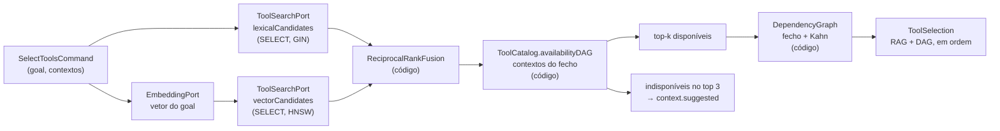
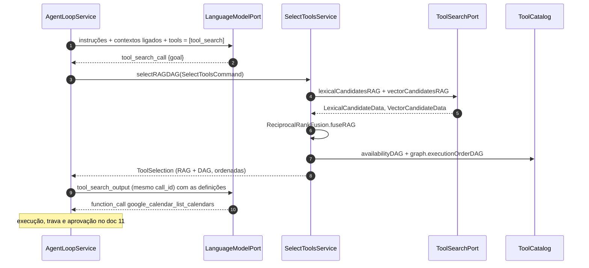

# 09 · Tool search, RAG e DAG

Como o modelo recebe **só** as ferramentas de que precisa, **na ordem certa**, e **só** dos
contextos que o usuário liberou. É a estratégia do `dta-tool-search` / `tool-search-pg`, aplicada
ao Google Workspace. ([ADR-0005](../adr/0005-tool-search-cliente-rag-dag.md))

> **Onde roda cada coisa:** o PostgreSQL só **guarda e indexa** (tabelas, GIN, HNSW) e devolve
> candidatos por `SELECT` simples. **Toda a estratégia é código Java no core**: fusão RRF, filtro de
> contextos, top-k, sugestões, fecho, Kahn, trava, disponibilidade e checagem de ciclo. Não existe
> função, view ou gatilho de RAG/DAG no banco ([doc 08](08-modelo-de-dados.md)).

## 1. O problema, aqui

O catálogo tem 50 ferramentas hoje e vai crescer (Tasks, Forms, Meet, Keep...). Mandar todas em toda
chamada custa tokens, quebra o cache do prompt quando o usuário liga/desliga um contexto e piora a
escolha (`google_docs_replace_text` × `google_slides_replace_text`). Além disso, algumas ferramentas
só funcionam depois de outras (o `messageId` vem da busca; não se altera o que não foi lido).

## 2. Pipeline



| Etapa | Classe (core) | Onde roda | Pergunta |
|---|---|---|---|
| 1. Embedding | `EmbeddingPort` → `OpenAiEmbeddingAdapter` | provedor | Qual o vetor do pedido? |
| 2. Candidatos | `ToolSearchPort` → `PostgresToolSearchAdapter` | banco (só `SELECT` com índice) | Quais 50 ferramentas mais próximas por texto e por vetor? Devolve `LexicalCandidateData` e `VectorCandidateData`, **sem filtro** |
| 3. Fusão | `ReciprocalRankFusion` | código | Qual a nota combinada de cada candidata? |
| 4. Disponibilidade | `ToolCatalog.availabilityDAG(...)` + `DependencyGraph.closureDAG(...)` | código | O contexto dela e os do fecho estão ligados (RN-02)? |
| 5. Corte | `SelectToolsService` | código | As `topK` melhores disponíveis; as indisponíveis entre as 3 melhores viram `BlockedTool` |
| 6. DAG | `DependencyGraph.executionOrderDAG(...)` | código | Do que elas **precisam** e em que **ordem**? |
| 7. Auditoria | `SearchHistoryRepository` | banco (`INSERT`) | Grava `tool_search` + `tool_search_result` |

Configuração (`nexo.retrieval.*`): `strategy` (`HYBRID`), `top-k` (5), `candidates` (50),
`rrf-k` (60), `apply-dag` (`true`), `suggestion-top` (3). Sem chave de embeddings, a estratégia cai
para `FULL_TEXT` automaticamente (como no tool-search-pg).

Se, depois do filtro, sobrarem menos de `top-k` disponíveis (catálogo grande com muitos contextos
desligados), o serviço pede candidatos de novo com o dobro (`100`, `200`), até um teto de 400.

## 3. RAG no código

### 3.1 O que vai ao banco

Só duas consultas, ambas para aproveitar índice (doc 08, seção 4):

| Consulta | Índice | Devolve |
|---|---|---|
| `lexicalCandidatesRAG(termos, n)`: `search_vector @@ to_tsquery(...)` ordenado por `ts_rank` | GIN em `tool.search_vector` (coluna gerada: nome peso A, namespace B, descrição C, `pt_unaccent`) | `List<LexicalCandidateData>(toolName, rank)` |
| `vectorCandidatesRAG(vetor, n)`: `ORDER BY embedding <=> :v LIMIT n` | HNSW cosseno em `tool_embedding` | `List<VectorCandidateData>(toolName, distance)` |

Os termos do full-text são montados no código (`LexicalTermsBuilder`): palavras do pedido unidas
por `|` (OU), para que uma palavra a mais no pedido não zere o resultado, como no tool-search-pg.

### 3.2 Fusão (Reciprocal Rank Fusion)

```java
public final class ReciprocalRankFusion {

    private final int k;

    public ReciprocalRankFusion(int k) {
        this.k = k;
    }

    public List<RankedTool> fuseRAG(
            List<ToolName> lexical,
            List<ToolName> semantic
    ) {
        Map<ToolName, Double> scores = new HashMap<>();

        this.vote(scores, lexical);
        this.vote(scores, semantic);

        return scores.entrySet()
                .stream()
                .map(entry -> new RankedTool(entry.getKey(), entry.getValue()))
                .sorted(RankedTool.BY_SCORE_THEN_NAME)
                .toList();
    }

    private void vote(
            Map<ToolName, Double> scores,
            List<ToolName> ranking
    ) {
        for (int position = 0; position < ranking.size(); position++) {
            scores.merge(ranking.get(position), 1.0 / (this.k + position + 1), Double::sum);
        }
    }
}
```

| Estratégia | Como | Bom em | Ruim em |
|---|---|---|---|
| `FULL_TEXT` | só a lista lexical, ordem do `ts_rank` | Nomes exatos: "planilha", "agenda", "rascunho" | Sinônimos: "compromisso" × "evento" |
| `VECTOR` | só a lista vetorial, ordem da distância | Sentido: "o que tenho amanhã?" → `list_events` | Siglas e termos raros |
| `HYBRID` (padrão) | `ReciprocalRankFusion.fuseRAG(lexical, vetorial)` | O melhor das duas, sem calibrar notas | — |

**Padrão de mercado** para RAG simples com Postgres: `vector(1536)` + **HNSW** `vector_cosine_ops`;
busca **híbrida** lexical + vetorial com **RRF** (mesma técnica de Elastic, OpenSearch, Weaviate e
Azure AI Search); documento derivado com hash para reindexar só o que mudou; embeddings gerados
fora do caminho da requisição e com o modelo gravado junto do vetor.

### 3.3 Documento e indexação

`ToolDocumentBuilder` (core) monta o texto que vira vetor: nome legível + namespace + descrição em
português + nomes dos parâmetros. `content_hash` = SHA-256 desse texto, calculado no código.
`IndexEmbeddingsService` compara com `IndexedEmbeddingData` (o que já está no banco) e gera vetor
só para o que é novo ou mudou.

## 4. DAG no código

O grafo é pequeno (33 arestas) e muda só com migration: o `CatalogLoaderService` lê `ToolData`,
`ToolParameterData` e `DependencyEdgeData` **uma vez** na subida e monta, pelo `ToolCatalogMapper`,
os modelos de domínio imutáveis `ToolCatalog` e `DependencyGraph` (pacote `catalog/domain/model`).

| Método de `DependencyGraph` | Algoritmo | Pergunta |
|---|---|---|
| construtor | DFS com três cores; achou aresta de volta → `DependencyCycleException` com o caminho (`a -> b -> a`) | O grafo é acíclico (RN-08)? |
| `closureDAG(Set<ToolName>)` | BFS pelas arestas `depends_on` | Se vou usar A, de quais outras preciso? |
| `levels(Set<ToolName>)` | memoização: nível = 0 sem pré-requisito, senão 1 + maior nível dos pré-requisitos | Em que "leva" cada uma fica pronta? |
| `executionOrderDAG(Set<ToolName>)` | **Kahn** no subgrafo do fecho: fila das de grau de entrada 0, processada por levas; dentro da leva, ordem alfabética | Em que ordem executar? (devolve `ExecutionPlan` com `PlanStep`s) |
| `missingPrerequisitesDAG(ToolName, Set<ToolName>)` | diferença entre pré-requisitos diretos e já executadas | Posso executar agora? (trava) |

A ordem alfabética dentro da leva deixa a saída **determinística**: mesma entrada, mesma lista,
o que mantém o prompt estável para o cache e os testes reproduzíveis. Ferramentas da mesma leva não
dependem umas das outras.

Acréscimo do Nexo: **disponibilidade por contexto** (`ToolCatalog.availabilityDAG(tools, enabledContexts)`,
RN-02). Para cada ferramenta, junta os contextos de todo o seu `closureDAG`; se algum estiver
desligado, ela fica `BlockedTool(name, missingContexts)`. Entregar ao modelo uma ferramenta que a
trava vai barrar de qualquer jeito só gastaria uma chamada.

Exemplo: pedido "troque o valor da célula B2 da planilha de orçamento para 300":

| step | ferramenta | origem | nível | depende de |
|:-:|---|:-:|:-:|---|
| 1 | `google_sheets_get_spreadsheet` | DAG | 0 | — |
| 2 | `google_sheets_get_values` | DAG | 1 | `get_spreadsheet` |
| 3 | `google_sheets_update_values` | RAG | 2 | `get_values` |

## 5. Como o modelo recebe as ferramentas

Modo padrão: **tool search no cliente** (Responses API, `execution: "client"`).



- A 1ª chamada só leva `tool_search` (+ as já carregadas na conversa, ver abaixo). O prefixo do prompt
  (instruções + `tools`) não muda entre chamadas: o cache de prompt continua valendo.
- Ferramentas carregadas ficam **carregadas no turno**. Entre turnos, o `AgentLoopService` reenvia as que
  foram usadas com sucesso nos últimos 3 turnos (heurística barata de "memória de ferramentas").
- `tool_search` aceita `{ "goal": string }`. A descrição dela lista os **namespaces** dos contextos
  ligados, para o modelo saber o que existe sem ver as definições.
- Modo alternativo `PRESELECTED` (`nexo.agent.exposure`): roda o pipeline com a mensagem do usuário
  antes da 1ª chamada e manda as funções direto. Útil para modelos sem tool search e para comparar.

## 6. Avaliação

`src/test/resources/retrieval/avaliacao.json`: ~60 pedidos em português com as ferramentas
esperadas. O teste `RetrievalEvaluationIT` (Postgres real, embeddings gravados em fixture para não
depender de rede) mede, por estratégia:

| Métrica | Meta |
|---|---|
| Recall@5 (só RAG) | ≥ 0,80 |
| Recall@8 com DAG | ≥ 0,90 |
| Pedidos com ferramenta de contexto desligado entregue | 0 |
| Latência p95 de `selectRAGDAG` sem embedding (2 SELECTs + fusão + DAG) | ≤ 50 ms |

### 6.1 Resultado medido no M0 (2026-10-13)

30 pedidos de `src/test/resources/retrieval/avaliacao.json`, pela API real, com embeddings
`text-embedding-3-small` gerados pelo proxy da DTA e `top-k = 5`:

| Estratégia | Recall@5 | Ferramentas entregues por pedido (com DAG) | p50 / p95 (com DAG) |
|---|:-:|:-:|---|
| `FULL_TEXT` | 0,87 | 5,1 de 50 | 5 ms / 5 ms |
| `VECTOR` | 0,93 | 6,3 de 50 | 240 ms / 283 ms |
| `HYBRID` (padrão) | **0,93** | 6,1 de 50 | 232 ms / 305 ms |

- A latência do vetorial/híbrido é quase toda a chamada de embedding do pedido ao proxy; a parte
  local (2 SELECTs + RRF + DAG) fica na casa do `FULL_TEXT` (RNF-05 atendido).
- Erros do híbrido: "ache o arquivo do orçamento no Drive" (`drive_search` empata com outras de
  Drive por "arquivo") e "mande no chat do time que a reunião mudou" (`chat_send_message` fora do top 5).
- O full-text sozinho (sem rede) é coberto pelo `RetrievalEvaluationIT` com piso de 0,70 e mede 0,87.
- Meta do doc 01 (Recall@8 ≥ 0,90 com DAG) atendida; a melhoria das descrições de Drive e Chat fica
  como ajuste de catálogo.

Exemplos do conjunto: "o que tenho amanhã?" → `calendar_list_events`; "arquiva os e-mails da
newsletter" → `gmail_search`, `gmail_modify_thread`; "quem tem acesso ao contrato?" →
`drive_search`, `drive_get_metadata` (DAG), `drive_get_permissions`; "manda no chat do time que a
reunião mudou" → `chat_list_spaces`, `chat_send_message`.
