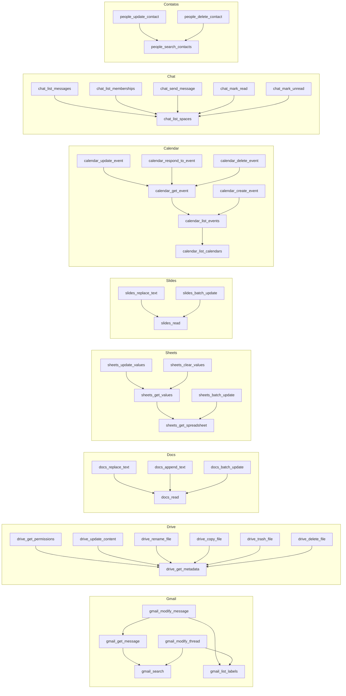

# 10 · Catálogo de ferramentas

O catálogo é **dado**, não código: a fonte é [`../catalogo/google-tools.json`](../catalogo/google-tools.json)
e a migration `V8__catalogo_google.sql` é gerada dele (RNF-10). As 50 ferramentas são as do
`google-tools` (`GoogleWorkspaceTools.mjs`), com três mudanças:

1. **descrições em português** (o RAG lexical usa `pt_unaccent` e o usuário escreve em português);
2. **efeito** explícito (`READ` / `WRITE` / `DESTRUCTIVE`) no lugar da lista `MUTATIONS` + severidade;
3. **`depends_on`**: as arestas do DAG.

## 1. Números

| Item | Quantidade |
|---|---:|
| Contextos | 8 |
| Namespaces | 16 |
| Ferramentas | 50 (20 `READ`, 26 `WRITE`, 4 `DESTRUCTIVE`) |
| Dependências (`depends_on`) | 33 |
| Níveis no DAG | 0 → 19 ferramentas · 1 → 23 · 2 → 5 · 3 → 3 |

## 2. Critérios das dependências

Uma aresta `A depends_on B` só existe por um destes motivos:

| Critério | Exemplo | Por quê |
|---|---|---|
| **Origem do identificador** | `gmail_get_message` ← `gmail_search` | O `messageId` só existe na saída da busca; sem ela o modelo inventa ids |
| **Ler antes de alterar** (read-before-write) | `docs_replace_text` ← `docs_read` | O assistente não altera o que não leu nesta conversa; o usuário vê o estado atual antes de aprovar |
| **Checar antes de criar** | `calendar_create_event` ← `calendar_list_events` | Evitar conflito de horário sem o usuário pedir |
| **Valor exigido pela API** | `people_update_contact` ← `people_search_contacts` | O `etag` atual vem da busca |

Não se cria aresta por "costuma vir antes". Dependências entre contextos são permitidas pelo
modelo de dados (RN-02 trata), mas o seed atual não tem nenhuma: cada contexto é independente,
então desligar um nunca derruba outro.

**Limite conhecido (POC):** a trava é por **nome** de ferramenta, não por recurso: ter lido o documento X
libera alterar o documento Y. Evolução prevista no doc 15: `tool_dependency.binding`
(ex.: `documentId = documentId`) e checagem do argumento no `ToolGatekeeperService`.

## 3. Grafo de dependências

Seta = "depende de" (aponta para quem roda antes). Ferramentas sem nenhuma aresta foram omitidas.



## 4. Ferramentas por contexto

Nível = posição no Kahn (0 = sem pré-requisitos). Todos os parâmetros são enviados ao modelo como
obrigatórios por causa do modo `strict` dos *function tools*; os opcionais aceitam string vazia
(ex.: `parentId` vazio = Meu Drive), como no `google-tools`.

### Gmail (`gmail`)

| Ferramenta | Efeito | Nível | Depende de | Parâmetros (* obrigatório) |
|---|---|:-:|---|---|
| `google_gmail_search` | READ | 0 | — | query*, maxResults* |
| `google_gmail_get_message` | READ | 1 | `google_gmail_search` | messageId* |
| `google_gmail_list_drafts` | READ | 0 | — | maxResults* |
| `google_gmail_list_labels` | READ | 0 | — | — |
| `google_gmail_create_draft` | WRITE | 0 | — | to*, subject*, body*, cc*, bcc* |
| `google_gmail_modify_message` | WRITE | 2 | `google_gmail_get_message`, `google_gmail_list_labels` | messageId*, addLabelIds*, removeLabelIds* |
| `google_gmail_modify_thread` | WRITE | 1 | `google_gmail_list_labels`, `google_gmail_search` | threadId*, addLabelIds*, removeLabelIds* |

### Drive (`drive`)

| Ferramenta | Efeito | Nível | Depende de | Parâmetros (* obrigatório) |
|---|---|:-:|---|---|
| `google_drive_search` | READ | 0 | — | query*, maxResults* |
| `google_drive_get_metadata` | READ | 0 | — | fileId* |
| `google_drive_list_recent` | READ | 0 | — | maxResults* |
| `google_drive_get_permissions` | READ | 1 | `google_drive_get_metadata` | fileId* |
| `google_drive_create_file` | WRITE | 0 | — | name*, content*, parentId* |
| `google_drive_update_content` | WRITE | 1 | `google_drive_get_metadata` | fileId*, name*, content* |
| `google_drive_rename_file` | WRITE | 1 | `google_drive_get_metadata` | fileId*, name* |
| `google_drive_copy_file` | WRITE | 1 | `google_drive_get_metadata` | fileId*, name*, parentId* |
| `google_drive_trash_file` | DESTRUCTIVE | 1 | `google_drive_get_metadata` | fileId*, name* |
| `google_drive_delete_file` | DESTRUCTIVE | 1 | `google_drive_get_metadata` | fileId*, name* |

### Docs (`docs`)

| Ferramenta | Efeito | Nível | Depende de | Parâmetros (* obrigatório) |
|---|---|:-:|---|---|
| `google_docs_read` | READ | 0 | — | documentId* |
| `google_docs_create` | WRITE | 0 | — | title*, initialText* |
| `google_docs_replace_text` | WRITE | 1 | `google_docs_read` | documentId*, find*, replace*, matchCase* |
| `google_docs_append_text` | WRITE | 1 | `google_docs_read` | documentId*, text* |
| `google_docs_batch_update` | WRITE | 1 | `google_docs_read` | documentId*, requestsJson* |

### Sheets (`sheets`)

| Ferramenta | Efeito | Nível | Depende de | Parâmetros (* obrigatório) |
|---|---|:-:|---|---|
| `google_sheets_get_spreadsheet` | READ | 0 | — | spreadsheetId*, ranges* |
| `google_sheets_get_values` | READ | 1 | `google_sheets_get_spreadsheet` | spreadsheetId*, range* |
| `google_sheets_create` | WRITE | 0 | — | title* |
| `google_sheets_update_values` | WRITE | 2 | `google_sheets_get_values` | spreadsheetId*, range*, values* |
| `google_sheets_clear_values` | WRITE | 2 | `google_sheets_get_values` | spreadsheetId*, range* |
| `google_sheets_batch_update` | WRITE | 1 | `google_sheets_get_spreadsheet` | spreadsheetId*, requestsJson* |

### Slides (`slides`)

| Ferramenta | Efeito | Nível | Depende de | Parâmetros (* obrigatório) |
|---|---|:-:|---|---|
| `google_slides_read` | READ | 0 | — | presentationId* |
| `google_slides_create` | WRITE | 0 | — | title* |
| `google_slides_replace_text` | WRITE | 1 | `google_slides_read` | presentationId*, find*, replace*, matchCase* |
| `google_slides_batch_update` | WRITE | 1 | `google_slides_read` | presentationId*, requestsJson* |

### Calendar (`calendar`)

| Ferramenta | Efeito | Nível | Depende de | Parâmetros (* obrigatório) |
|---|---|:-:|---|---|
| `google_calendar_list_calendars` | READ | 0 | — | — |
| `google_calendar_list_events` | READ | 1 | `google_calendar_list_calendars` | timeMin*, timeMax*, query*, maxResults* |
| `google_calendar_get_event` | READ | 2 | `google_calendar_list_events` | eventId*, calendarId* |
| `google_calendar_create_event` | WRITE | 2 | `google_calendar_list_events` | summary*, start*, end*, calendarId*, description*, attendees* |
| `google_calendar_update_event` | WRITE | 3 | `google_calendar_get_event` | eventId*, calendarId*, summary*, start*, end*, description* |
| `google_calendar_respond_to_event` | WRITE | 3 | `google_calendar_get_event` | eventId*, calendarId*, responseStatus* |
| `google_calendar_delete_event` | DESTRUCTIVE | 3 | `google_calendar_get_event` | eventId*, calendarId*, summary* |

### Chat (`chat`)

| Ferramenta | Efeito | Nível | Depende de | Parâmetros (* obrigatório) |
|---|---|:-:|---|---|
| `google_chat_list_spaces` | READ | 0 | — | pageSize* |
| `google_chat_list_messages` | READ | 1 | `google_chat_list_spaces` | space*, pageSize* |
| `google_chat_list_memberships` | READ | 1 | `google_chat_list_spaces` | space*, pageSize* |
| `google_chat_send_message` | WRITE | 1 | `google_chat_list_spaces` | space*, text* |
| `google_chat_mark_read` | WRITE | 1 | `google_chat_list_spaces` | space* |
| `google_chat_mark_unread` | WRITE | 1 | `google_chat_list_spaces` | space* |

### Contatos (`people`)

| Ferramenta | Efeito | Nível | Depende de | Parâmetros (* obrigatório) |
|---|---|:-:|---|---|
| `google_people_get_profile` | READ | 0 | — | — |
| `google_people_search_contacts` | READ | 0 | — | query*, pageSize* |
| `google_people_create_contact` | WRITE | 0 | — | givenName*, familyName*, email*, phone* |
| `google_people_update_contact` | WRITE | 1 | `google_people_search_contacts` | resourceName*, etag*, givenName*, familyName*, email*, phone* |
| `google_people_delete_contact` | DESTRUCTIVE | 1 | `google_people_search_contacts` | resourceName*, name* |

## 5. Aprovação por efeito

| Efeito | Aprovação | Severidade | Ferramentas |
|---|:-:|---|---|
| `READ` | não | — | buscas, listas, leituras |
| `WRITE` | sim | `warning` | criar, alterar, enviar mensagem, marcar lido |
| `DESTRUCTIVE` | sim | `danger` | `drive_trash_file`, `drive_delete_file`, `calendar_delete_event`, `people_delete_contact` |

> Diferença consciente: no `google-tools`, `drive_trash_file` era `warning`. Aqui é `DESTRUCTIVE`
> porque some da vista do usuário e de quem tem acesso compartilhado.

A descrição legível de cada aprovação (ex.: *Criar evento "Reunião" de 10:00 a 11:00*) vem de um
template por ferramenta no `ApprovalDescriber` (adapter), em português, com os mesmos campos que o
`google-tools` usa em `approval()`.

## 6. Formato do JSON

```json
{
  "version": 1,
  "contexts":   [{ "key": "calendar", "name": "Calendar", "description": "...", "google_api": "calendar-json.googleapis.com", "scopes": ["https://www.googleapis.com/auth/calendar"] }],
  "namespaces": [{ "name": "google_calendar_event", "context": "calendar", "description": "Calendar - eventos e convites." }],
  "tools": [{
    "name": "google_calendar_create_event",
    "namespace": "google_calendar_event",
    "effect": "WRITE",
    "description": "Cria um evento na agenda (reunião, compromisso) com horário e participantes.",
    "depends_on": ["google_calendar_list_events"],
    "dag_level": 2,
    "parameters": [{ "ordinal": 1, "name": "summary", "type": "string", "description": "Título do evento.", "required": true }]
  }]
}
```

`dag_level` é informativo (conferência); o `DependencyGraph` recalcula na subida e o teste `CatalogSeedIT` compara.
O gerador da migration valida: nomes únicos e no padrão `^[a-z][a-z0-9_]{1,63}$`, namespace e
contexto existentes, pré-requisitos existentes, ausência de ciclo e `dag_level` igual ao calculado.

## 7. Como adicionar uma ferramenta

1. Acrescentar no JSON (namespace, efeito, descrição em português, parâmetros, `depends_on`).
2. `python3 scripts/gerar_migration_catalogo.py` → nova migration `V<n>__catalogo_<assunto>.sql` só com o diff.
3. Implementar o executor no adapter (`*Executor`) e o template de aprovação, se for mutação.
4. Acrescentar pedidos ao conjunto de avaliação do RAG (doc 09, seção 6).
5. Na subida, `EmbeddingIndexOnStartup` gera o vetor só da ferramenta nova (`content_hash`).
