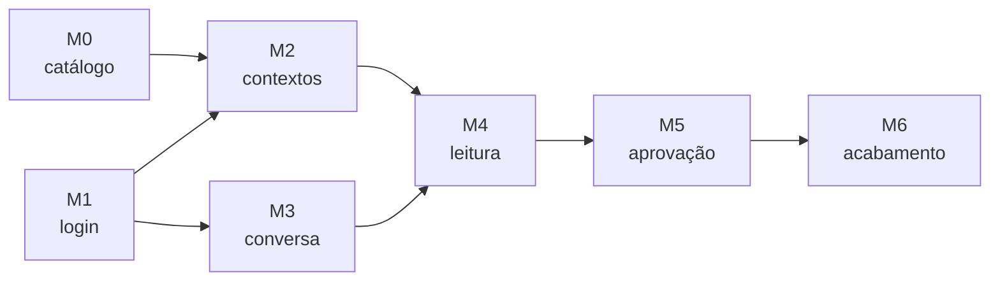

# 15 · Roadmap

Marcos pequenos, cada um utilizável e demonstrável sozinho (como no alien-code). Um marco só fecha
com a Definition of Done do doc 14.

| | Marco | Entrega | Requisitos |
|:-:|---|---|---|
| ✅ | **M0 · Esqueleto e catálogo** | Repositório, `compose.yaml` (pgvector), `nexo-server` vazio com Flyway V1–V8, gerador da migration do catálogo, `CatalogLoaderService` + `DependencyGraph` + `ReciprocalRankFusion` no core, `GET /api/catalog*`, `POST /api/search` sem usuário (todos os contextos), indexação de embeddings na subida, avaliação do RAG | RF-30, RF-37, RF-38, RN-08 |
| ✅ | **M1 · Login Google** | Spring Security OIDC + PKCE, Spring Session JDBC, `app_user`, `google_credential` cifrada, `/api/me`, logout, desconectar; `nexo-web` com login e shell | RF-01..05, RNF-01..03 |
| ✅ | **M2 · Contextos** | Tela de contextos, consentimento incremental, `user_context`, filtro de contextos nas buscas (`ToolCatalog.availabilityDAG`), `GET /api/search/history` | RF-10..14, RN-01..03, RN-09 |
| ✅ | **M3 · Conversa ao vivo** | Conversas (REST), Event Store, WebSocket com replay, `user.message`, streaming do modelo, Parar, recuperação após reinício | RF-20..23, RF-25..26, RNF-07..08 |
| ✅ | **M4 · Ferramentas de leitura** | Tool search no cliente, RAG + DAG no laço, `ToolGatekeeperService` (contexto + trava), executores `READ` dos 8 contextos, eventos `tool.*` e `context.suggested` | RF-24, RF-31..34, RN-02..04 |
| ✅ | **M5 · Alterações com aprovação** | `tool_approval`, `approval.decide`, `ApprovalExpirer`, `ApprovalDescriber`, executores `WRITE`/`DESTRUCTIVE`, cartões de aprovação | RF-35..36, RN-05..07 |
| ⏳ | **M6 · Acabamento** | Métricas, logs com redação, rate limit, apagar meus dados | RNF-04..06, RNF-11 |

Já entraram antes do M6, porque o laço precisava deles: limites por turno (RN-11), título automático
da conversa (1º turno) e tema escuro com troca manual.

### Estado do M1 ao M5 (2026-10-13)

- **Testado sem Google:** `mvn verify` roda 94 testes unitários e 19 de integração. O `AgentFlowIT`
  usa um servidor HTTP local no lugar do modelo, do endpoint de token e das APIs do Google, e passa
  por WebSocket de verdade (sessão JDBC, CSRF, replay, aprovação, Parar, trava do DAG, contexto
  desligado, `context.changed`, desconectar).
- **Testado com o modelo real:** `NEXO_LIVE=1 mvn verify -Dit.test=LiveModelIT` usa o proxy do `.env`:
  leu a agenda pelo tool search e criou um evento depois da aprovação (Google ainda falso).
- **Falta para usar com uma conta Google de verdade:** criar o OAuth Client Web no Google Cloud
  (doc 04, seção 2) e pôr `GOOGLE_CLIENT_ID`/`GOOGLE_CLIENT_SECRET` no `.env`. Sem isso o login
  redireciona ao Google com `client_id=nao-configurado` e o Google recusa.

### Ordem e dependências

M0 e M1 podem andar em paralelo.

## Demonstração de cada marco

| Marco | Demonstração |
|---|---|
| M0 | `curl /api/catalog/plan?tools=google_sheets_update_values` (Kahn no código); `curl /api/search` com "agende uma reunião" |
| M1 | Entrar com Google, ver nome e foto, sair, entrar sem novo consentimento |
| M2 | Ligar Calendar (vai ao Google), desligar, religar (não vai); `/api/search` não traz Gmail com Gmail desligado |
| M3 | Conversa de texto ao vivo; derrubar a rede no meio e ver a resposta completa ao reconectar |
| M4 | "O que tenho amanhã?" com a timeline mostrando busca, DAG e chamadas reais |
| M5 | "Marque reunião amanhã 10h com fulano" → cartão de aprovação → evento criado no Google Calendar |
| M6 | Painel de métricas; teste de carga simples |

## Futuro (fora da POC)

| Item | Ideia |
|---|---|
| RAG sobre conteúdo | Indexar trechos de Docs/Drive escolhidos pelo usuário (`document_chunk` com `vector`, mesmo padrão híbrido) para perguntas sobre o conteúdo |
| `drive.file` + Google Picker | Trocar o escopo restrito `drive` pelo não restrito `drive.file`, com o usuário escolhendo os arquivos |
| Trava por recurso | `tool_dependency.binding` para exigir que a leitura tenha sido do **mesmo** `documentId`/`fileId` |
| Mais contextos | Tasks, Forms, Meet, Keep |
| Voz | Delegação GPT-Live como no `google-tools` |
| Provedor de LLM local | Adapter de `LanguageModelPort` para Ollama (sem tool search: modo `PRESELECTED`) |
| Publicação | Verificação do app no Google e avaliação CASA para Gmail/Drive |
